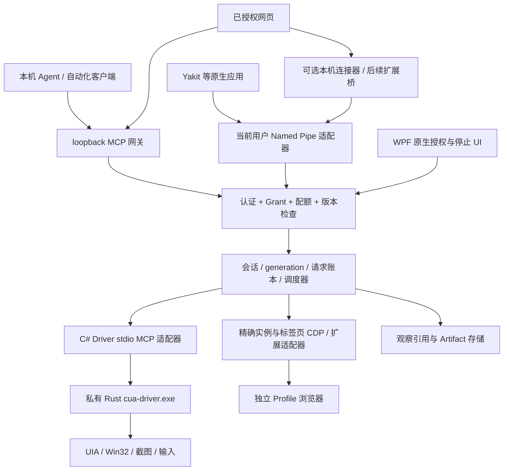

# Windows 统一浏览器与系统控制实施任务书

本文面向后续实施 Agent。交付目标是让外部 AI Agent、经用户授权的网页、Yakit 和普通自动化程序，通过 YTray 发现并操作本机浏览器与当前用户桌面。本文规定设计、改动位置、实施依赖和验收方法；**本 PR 只交付任务书，不代表下述新增功能已经实现。**

核对日期：2026-11-06（Asia/Shanghai）。代码基线：`main` 的 `22d46916e4818b6ecbe29a2772ee85743c41e258`，远端为 `https://github.com/yaklang/ytray`。实施前先比较最新默认分支，保留本文的安全与契约要求，按实际代码调整文件位置。

## 1. 产品目标与职责

YTray 本身没有 AI 能力：不内置模型，不运行自然语言规划，不保存模型配置，不调用模型，也不安装感知模型。外部 Agent 决定下一步，YTray 负责资源发现、连接授权、临时会话、动作执行、观察、确定性状态验证、结构化错误和停止。界面使用“系统操作”“连接客户端”“授权范围”等措辞，不增加 AI 对话框。

首发形成两条受控链路：

1. 浏览器：复用独立 Profile、浏览器实例、现有 CDP 与 Yakit Browser Agent；按实例和精确标签页授权及执行。
2. 桌面：保留 C# / WPF 宿主，私有启动官方用户态 Rust `cua-driver.exe`；使用其 Windows UI Automation、截图和输入实现。这里的 Driver 是普通用户态程序，不是内核驱动，不需要安装 `.sys`。

不在首发范围：模型推理、任务规划、无人值守跨用户控制、UAC 自动批准、管理员提权、Session 0 桌面服务、通用 shell/脚本执行、自动接管用户日常浏览器 Profile、远程公网监听、多屏全覆盖保证和任意应用后台输入保证。

### 1.1 资源模型

| 实体 | 身份、生命周期和关系 |
| --- | --- |
| BrowserInstance | 延用 `BrowserInstance.Id`、Profile 路径、运行时和历史；重启同一 Profile 保留实例 UUID，但产生新的运行代次和 CDP 连接。标签页必须再绑定 `target_id`，不能只凭端口识别。 |
| DesktopResource / 系统实例 | 指向当前用户 SID、Windows Session ID、交互式 window station/desktop 与主显示器。不是新桌面、虚拟机或隔离用户；不复用浏览器 Profile 的隔离承诺。 |
| ClientIdentity | 网页绑定精确 Origin 和本地配对记录；原生客户端绑定经核验的进程身份与配对公钥/凭据。`display_name` 只供展示，不能用作认证。 |
| Grant | 用户在原生 UI 主动创建/批准的权限上限，绑定客户端、资源、scope、TTL 和撤销代次；多个会话可依赖同一 Grant，不能超出它。 |
| ControlSession | 临时控制租约，绑定一个客户端、Grant、资源和 runtime generation。Driver 的 `session` 标签由 YTray 内部生成并映射；它不是凭据。 |
| Observation | 某个精确目标的一次有界观察，持有会话、代次、目标 fingerprint、有效期、树/截图完整性；不承诺截图与 UIA 树在同一 CPU 时刻原子采集。 |
| ElementRef / CaptureRef | Observation 内的短期引用；只在原会话、代次与目标有效。Driver 的 `element_token`、`capture_id` 为内部值，不能直接作为 YTray 的授权凭据。 |
| Action | 具有 `request_id`、deadline、exact target、delivery mode、观察引用和预期后置条件的单次操作；结果区分是否投递、是否确认效果。 |
| Artifact | 截图等产物，绑定客户端/Grant/会话；对外使用不透明 ID，单独鉴权下载，不返回任意磁盘路径或永久公开 URL。 |

多桌面会话共享同一屏幕、焦点、键盘、鼠标和剪贴板；Driver session 不提供桌面隔离。即使拥有多个 Driver 进程，真实输入仍须由 YTray 全局串行调度。浏览器 Profile 只隔离 Cookie、Local Storage、缓存、插件和登录态，也不隔离 OS 文件、显示器与输入设备。

### 1.2 总体架构



所有入口进入同一授权及调度层，不能让网页/原生客户端直连私有 Driver 或直接获得 CDP WebSocket URL。对外 MCP 与内部 Driver MCP 是两套连接，版本、request ID、session 均独立管理。

## 2. 实际基线盘点与复用边界

### 2.1 已合入代码

以下路径相对仓库根目录，均已在上述基线只读核对；Windows 工程没有 `src/YTray/` 中间层，README 中旧目录树不是实施依据。

| 现有文件 / 类 | 已有行为 | 实施时的复用与限制 |
| --- | --- | --- |
| `windows/src/YTray.csproj`、`windows/build.ps1` | 旧式 MSBuild WPF 工程，C# 9、`TargetFrameworkVersion=v4.8.1`、nullable 编译门禁；`amd64`/`386` 对应 `x64`/`x86`。 | 保持宿主与构建体系；.NET Framework 不是 .NET 8，不能直接使用 `Process.WaitForExitAsync`、`Process.Kill(entireProcessTree: true)` 或 `ProcessStartInfo.ArgumentList` 等新 API。 |
| `Models/Models.cs`、`Core/InstanceStore.cs` | 实例/历史/设置、独立 Profile、恢复、进程管理、页面轮询、MCP 状态、短期 Yakit 启动批准；UI 集合受 Dispatcher 管理。 | 浏览器资源注册仍由它维护；新增系统控制逻辑放独立 Controller，避免继续扩充这个大类。已有 Yakit 启动批准只覆盖特定浏览器配对，不代表桌面授权。 |
| `Core/BrowserLauncher.cs` | 启动参数、隔离目录、调试端口、插件 bootstrap、运行时身份与引擎目标传递。 | 保持已有用户身份与连接选择；不能把“启动成功”作为后续网页业务成功。 |
| `Core/BrowserEngineDiscovery.cs` / `BrowserEngineTarget` | 从本机 `/discovery` 发现协议 v3 的 Yak 引擎，支持 engine/legacy/none 并恢复选择。 | 是浏览器插件连接发现，不是新网关的可信客户端目录；发现名称/地址不能替代配对。 |
| `Core/BrowserExtensionService.cs` / `BrowserDevTools` | 浏览器级 CDP：校验 loopback `/devtools/browser/` 地址；`Extensions.getExtensions/loadUnpacked` 加载及验证、旧引擎兼容回退。 | 继续复用；当前连接按请求顺序读写，不能直接作为多客户端并发 CDP 路由。 |
| `Core/ScreenshotService.cs` | `/json/list` + `ClientWebSocket`，页面状态、导航、截图和缩略图；部分方法按可见页或第一个 page 回退选择。 | 保留用户主动截图流程；**对外自动化另加 exact-target 适配器**，不得复用“找不到就选第一页”行为。 |
| `Core/McpServer.cs` / `McpServer` | `127.0.0.1:19222/mcp`，手写 `TcpListener` HTTP，5 个工具：`list_browser_runtimes`、`list_browser_instances`、`open_browser_instance`、`focus_browser_instance`、`stop_browser_instance`。实例结果含 `debug_port`；声明 2026-07-28 及 legacy 版本。 | 保留入口及已有客户端迁移路径；当前无 Bearer/Grant 认证，缺 Origin 被允许，只有 POST 路由且无网页 CORS 预检。桌面能力接入前必须加固；普通 Grant 隐藏调试端口等原始连接信息，不能直接转发新 Driver 工具。 |
| `Core/NativeControlServer.cs` | `ytray-control-v1` Named Pipe，当前用户 SID 的 `PipeSecurity`，一行 JSON/一条回复；`list_history`、`restore_history`、`claim_launch_approval`。 | 现有浏览器 IPC，不是 MCP。保留消息格式并迁移认证，新协议用 v2 管道。当前先 `ReadLineAsync` 再检查 64 KiB，缺读取 deadline 和客户端进程/会话核验，不能沿用到高权限桌面链路。 |
| `Native/Win32.cs`、`Native/WindowEnum.cs`、`Core/BrowserWindowTaskbarController.cs` | P/Invoke、窗口枚举/聚焦、AUMID、STA WinEvent Hook、任务栏生命周期。 | 复用安全句柄与窗口身份检查经验；现有“第一个可见窗口”不是 exact target，任务栏线程不承担 UIA 执行。 |
| `Core/StatePersistence.cs` | `%LOCALAPPDATA%\YTray\state.json`、临时文件替换、当前用户 ACL。ACL 设置为 best effort。 | 仅保存偏好和非敏感历史；Grant 令牌、临时 session、截图与 UIA 内容不能混入 state.json。安全运行时目录 ACL 失败必须 fail closed。 |
| `Core/RuntimeInstaller.cs`、`ExtensionInstaller.cs`、`AppUpdateService.cs`、`NativeAppUpdater.cs` | 浏览器/插件下载校验和 YTray 自身更新；WinSparkle 资源嵌入、Costura/Fody 打包。 | 复用下载校验思路，Driver 独立固定清单和版本目录；不能把 Chrome 安装器当 Driver 安装器。 |
| `Core/DiagnosticLog.cs` | 滚动日志、长度限制、凭据与用户目录脱敏。 | 扩展为只记请求元数据与错误码，默认不记输入文本、UIA 树、图像、完整 URL、令牌。 |
| `App.xaml.cs`、`Views/TrayApp.xaml.cs`、`Views/ManagerView.xaml(.cs)`、`Views/Pages/McpPage.xaml(.cs)` | App 创建 IPC，Store 管理 MCP，现有托盘、小组件、管理页和 MCP 配置页。 | 新增独立“系统操作”页，统一原生停止入口与退出顺序；MCP 浏览器服务可运行而桌面控制仍关闭。 |
| `windows/tests/YTray.Tests.csproj` | .NET Framework 4.8.1，MSTest 2.2.10；现有 `McpServerTests`、`YakitAutoApprovalTests`、`BrowserEngineTargetTests` 等。 | 使用同一测试项目与 `vstest.console.exe`，新增 fixture 项目须显式接入 solution/build，不假设 `dotnet test` 可替代。 |

本基线还没有 `SystemControlController.cs`、`CuaDriverConnection.cs` 或系统控制页面，也没有 Driver 二进制分发、桌面工具代理和本文定义的 Grant/Observation 契约。已有 MCP 服务的存在不能视为桌面网关已经完成。

### 2.2 其他工作区的未合入参考

只读参考过 `/Users/v1ll4n/Projects/ytray/darwin/Sources/YTray/` 的 `SystemControlController.swift`、`CuaDriverConnection.swift`、`SystemControlViews.swift`、`MCPHTTPServer.swift`、`YTrayMCPService.swift` 及 `darwin/Tests/YTrayTests/SystemControlTests.swift`。核对时这些文件仍有未跟踪/未提交改动；另有未合入的 Windows 页面文件，均不属于本基线、不复制进本 PR。该目录由另一个会话维护，后续 Agent 不应在那里修改文件。

可以复用的设计意图：原生主动开启、短期令牌、精确 Origin、前台输入单独授权、Driver generation、schema 过滤、连接失败可重试、停止清理。不能照抄的内容：macOS TCC/Bundle ID/LaunchServices、私有 Unix socket、当前草稿中的端口与协议版本、持久化 MCP token 方式，以及简单工具名/字段白名单就等同完整授权的假设。Windows 使用本文更细的 Grant 与引用模型；未来 macOS 对齐同一外部契约时，另开实现改动。

## 3. Windows 接入决策与进程生命周期

### 3.1 选型

| 路径 | 决策与理由 |
| --- | --- |
| C# / WPF → 私有 Rust EXE → stdio MCP | **首选。** 跨进程不受宿主位数限制，协议可测试，Driver 崩溃可隔离，不引入 Node/Python，YTray 可独占运行时和停机权限。每个不可变权限上限使用一个私有 runtime；首发只允许一个桌面控制会话。 |
| C# 进程内 Rust FFI / UniFFI | 延后。官方 SDK 当前面向 Python/TypeScript；没有核对到可直接使用且维护承诺明确的 C# SDK。自行 P/Invoke 动态库会增加 ABI、位数、COM 线程和崩溃风险。参考 [官方 SDK](https://cua.ai/docs/cua-driver/guides/use-the-sdk)。 |
| `serve` + 私有 Named Pipe + `mcp --socket` | 后续多个连接必须共享 runtime、或本机连接器需要跨进程保持会话时再评估。增加 daemon/proxy 两层生命周期与认证，不为首发多加常驻服务。官方有 daemon/pipe 路径，但不能把其同用户 ACL 等同于 YTray Grant。参考 [CLI 运行配置](https://cua.ai/docs/cua-driver/reference/cli/serve-and-configure)。 |
| Windows Service / Session 0 | 不采用。控制进程必须在用户交互式会话中；服务即使同 SID 也不等于连接到了该桌面。[Microsoft Interactive Services](https://learn.microsoft.com/en-us/windows/win32/services/interactive-services)。 |

官方说明 Windows 的 MCP 进程可直接拥有 runtime，stdin EOF 结束；选择该私有进程路径的依据见 [How Cua Driver works](https://cua.ai/docs/cua-driver/concepts/how-cua-driver-works)。固定版本仍需 WP1 实测其行为，不能把 macOS daemon 归属规则套到 Windows。

### 3.2 stdio 连接实现

新增 `ICuaDriverTransport`、`CuaDriverConnection`、`DriverProcessFactory`，明确以下步骤：

1. 用户批准后，解析固定版本的绝对 EXE 路径，验证架构、文件 SHA-256、发布清单、资源目录 ACL。禁止从 `PATH` 或用户请求的任意路径找 Driver，禁止通过 `cmd.exe`/PowerShell 启动。
2. 构造 `ProcessStartInfo`：`UseShellExecute=false`、`CreateNoWindow=true`、重定向 stdin/stdout/stderr、UTF-8 无 BOM、固定工作目录。Framework 4.8.1 使用正确 Windows argv 引用函数构造 `Arguments`，只允许宿主生成的参数。下述生产级 Job 启动器不能直接靠 `Process.Start` 完成。
3. 清理继承的 `CUA_DRIVER_*` 环境变量，显式配置权限上限；推荐 `CUA_DRIVER_PERMISSION_MODE=bounded`、`CUA_DRIVER_CAPABILITY_MANIFEST_FILE=<当前用户私有临时文件>`、`CUA_DRIVER_CAPABILITY_MANIFEST_APPROVED=1`，仅在用户审阅同一份 manifest 后设置。`mcp` 命令的授权配置通过环境，不把 `serve` 的授权 flags 填到 `mcp` argv。禁用不需要的可选 HTTP listener、扩展安装与自动更新；具体环境开关必须由固定版本 CLI/源码确认，不能靠未知变量声称生效。[Driver 权限配置](https://cua.ai/docs/cua-driver/guides/permissions)。
4. stdout 后台 reader 使用有字节上限的增量 UTF-8 解码器，按 LF 分帧，兼容 CRLF；一行一个完整 JSON-RPC 消息，JSON 字符串换行必须转义，不能使用 LSP `Content-Length` 帧头。stdin 只有一个异步 writer 队列；读取、写入、stderr 和进程退出监听同时启动，防双向管道堵塞。[MCP stdio](https://modelcontextprotocol.io/specification/2026-07-28/basic/transports/stdio)。
5. 对内先发送 legacy `initialize`，检查选择版本、serverInfo 和 capabilities，再发 `notifications/initialized`，之后 `tools/list`（含分页）、只读权限/健康探测；为每个控制租约显式 `start_session` 建立宿主生成的 named session，后续调用固定映射。manifest 只允许宿主所需的 start/end session、只读健康工具与批准的动作集合；这些内部生命周期工具不向外部客户端转发。Driver 内部实际支持版本以固定 EXE 握手为准；优先测 `2025-11-25`，没有兼容交集就 `VersionIncompatible`。不把对外 2026 协议元数据塞到 legacy Driver 连接。
6. 使用单调递增 JSON-RPC ID 和 `ConcurrentDictionary<id, PendingRequest>` 关联回复；Pending 包含 generation、deadline、取消注册和 `TaskCompletionSource`，使用异步 continuation。乱序响应、notification、重复/迟到回复不能误配。运行时退出一次性完成全部 pending；新 generation 不接收旧 reader 的回调。
7. stderr 持续排空，只保留脱敏后最后 64 KiB，单条最多 8 KiB，限频落日志；stdout 非协议内容、无换行超限、非法 UTF-8/JSON、超大回复都作为协议错误停用 runtime。拟定上限：普通请求 1 MiB、Driver 响应帧 24 MiB（含 base64 截图）、树最多 5,000 节点/32 层；到上限返回完整性标记，不能静默裁剪 required 字段。
8. 所有 I/O 与 Driver 等待在后台；WPF 只通过 `Dispatcher.InvokeAsync` 更新 Observable 状态、展示授权和停止结果。不得在 UI 线程 `.Wait()`/`.Result`，不能在 Dispatcher 内等待 Driver/UIA。Framework 4.8.1 用 `Exited` + TCS 实现退出等待，取消读取可关闭底层 stream；不能假设 `ReadLineAsync` 可取消。

manifest 是 runtime 的不可变权限上限，Grant 变化默认重启 runtime 并递增 generation。工具列表取“固定版本实际 schema ∩ YTray 已审阅能力 ∩ Grant ∩ 当前目标支持”，没有字段/语义证明就不暴露。schema 中出现文件路径、script、settings、批准或启动工具时不能原样代理。

### 3.3 Job Object、防孤儿与关闭

`Process.Kill()` 在 Framework 4.8.1 不负责整棵进程树。采用 `CreateJobObject` + `SetInformationJobObject(JobObjectExtendedLimitInformation)`，设置 `JOB_OBJECT_LIMIT_KILL_ON_JOB_CLOSE`，Job handle 只由 YTray 持有且不继承；不设置 breakaway。最后一个 Job handle 关闭会终止该 Job 中的进程，因此 Driver 不得继承该 handle，客户端也不能持有它。[Job Objects](https://learn.microsoft.com/en-us/windows/win32/procthread/job-objects)、[LimitFlags](https://learn.microsoft.com/en-us/windows/win32/api/winnt/ns-winnt-jobobject_basic_limit_information)。

**生产启动必须消除“先启动再 Assign”的窗口。** WP1 可以用 `ProcessStartInfo/Process.Start` 验证 stdio 协议，不能宣称其满足崩溃防孤儿验收。WP2 在 `Native/DriverProcessLauncher.cs` 用 `CreateProcessW` / `STARTUPINFOEX` 的 `PROC_THREAD_ATTRIBUTE_JOB_LIST` 在创建阶段绑定 Job，同时用受限 handle list 继承三个 stdio 管道；C# `Process` 负责退出/身份观察，受控 `FileStream` 负责原生创建的管道。测试 inherited handle、嵌套 Job、启动失败释放、32/64 位结构对齐和父进程在创建期被杀。[UpdateProcThreadAttribute](https://learn.microsoft.com/en-us/windows/win32/api/processthreadsapi/nf-processthreadsapi-updateprocthreadattribute)。

不把“`CREATE_SUSPENDED` 后 Assign 再 Resume”说成完全消除了父进程在两步间退出留下挂起进程的风险。若特定系统策略不允许 Job 绑定，桌面控制应显示不可用并拒绝启动；不能静默转成无监管进程。创建期极端终止语义仍需压力测试，不能承诺任何系统故障都绝无孤儿。

运行与关闭约定：

- Driver 的 SID、`Process.SessionId` 必须和已批准的交互式用户会话一致；不是“找一个 explorer.exe 的 PID”后附着。RDP/用户切换按第 4 节停用处理。
- 正常停止先撤销 Grant、递增撤销代次、拒绝新请求，再取消未投递队列、终结会话；在最多 2 秒的拟定宽限内尝试 Driver `end_session`、关闭 stdin 等待 EOF 退出；超限调用 `TerminateJobObject`，观察退出后关闭句柄。不能在先等慢请求返回之后才撤权。
- 意外退出时 Pending 请求按已投递情况转为 `Unknown`/`NotStarted`，清理观察/产物引用，UI 显示退出码与脱敏诊断。允许用户重新连接，禁止自动恢复有输入权限的会话或自动重放。
- 取消和单请求 timeout 不直接证明 Driver 没执行；可协作取消则发送协议取消，否则隔离并终止 runtime，递增 generation。强制终止不能回滚已生效输入，也可能影响尚未确认的操作。
- Job 只包含 YTray 创建的 Driver/helper；不能将用户已运行的应用或既有浏览器加入 Job。首发 Driver 工具不开放 launch/kill app；应用停止与浏览器停止仍需各自 scope。

### 3.4 后续 Named Pipe 方案

继续区分两类 Pipe：Yakit 到 YTray 的 IPC，与 YTray 到 Driver daemon 的内部连接。首发仅后者不用 daemon；已有 `ytray-control-v1` 保留浏览器消息格式兼容。WP3 必须为其历史读取/恢复/claim 加入对端身份及原生批准的兼容 Grant；未配对调用方收到迁移/授权错误，不能用旧管道绕开新网关。v1 不新增桌面动作，也不因同用户 SID 自动允许其所有命令。

新 IPC 使用 `ytray-control-v2-<SID摘要>-<SessionId>`，内部 daemon endpoint 还应加不可预测实例随机数。`PipeSecurity.SetAccessRuleProtection(true, false)` 关闭继承，只向当前 SID 授予所需读写权，不给 Everyone/Anonymous/Users；避免泛化 FullControl/创建新 pipe 实例权限。原生 pipe 加 `FILE_FLAG_FIRST_PIPE_INSTANCE` 防抢占及 `PIPE_REJECT_REMOTE_CLIENTS` 拒绝远端，ACL 失败即停用。默认 pipe DACL 并不满足要求。[Named Pipe Security](https://learn.microsoft.com/en-us/windows/win32/ipc/named-pipe-security-and-access-rights)。

建立连接后通过 `GetNamedPipeClientProcessId`、客户端 token SID/SessionId、进程创建时间、规范化 EXE 路径及可用签名核验对端；客户端用 server PID 反向检查 YTray。SID 仅证明用户账号，不能证明“它就是 Yakit”。配对凭据/短期 token、challenge nonce 和客户端身份仍要校验；display name、管道名或同 SID 均不自动授权。身份不可读取时 fail closed。[客户端 PID API](https://learn.microsoft.com/en-us/windows/win32/api/winbase/nf-winbase-getnamedpipeclientprocessid)。

v2 明确采用有界 UTF-8 NDJSON，一行一 envelope；分块读取达到上限立即断开，不等完整 `ReadLineAsync`。连接握手/空闲/单请求分别设 deadline，慢客户端不能占满唯一 pipe 实例；每连接有限队列并支持并发只读，所有动作仍进入统一调度器。Driver 自有 pipe 的实现与 schema须核对固定源码，不擅自替换其 framing 或 ACL。

## 4. Windows 桌面接口与行为

### 4.1 所有权与 exact target

Driver 负责 Windows UIA/COM、窗口截图和实际输入；YTray 负责授权、身份绑定、引用注册、调度与结果包装，不重写一套 UIA 执行引擎。宿主需要的少量 Win32 查询仅用于核验身份/会话、DPI 几何和停止。

新增 `WindowsTargetResolver`：枚举后生成不透明 `target_ref`，保存 HWND、PID、`GetProcessTimes` 创建时间、规范化 executable path、用户 SID、Session ID、窗口所属 desktop、runtime generation；调用前用 `IsWindow`、`GetWindowThreadProcessId` 和进程创建时间重新核对。PID、HWND 都可能复用，单靠窗口标题、进程名、AUMID 或 PID 不足以绑定身份。新弹窗即使属于同 PID 也要形成新目标；默认不跟随“当前活动窗口”。有明确 parent/owned-window 策略时可授权同应用新窗，但需新 Observation。

目标匹配不唯一返回 `TargetAmbiguous`，目标退出/身份变化返回 `TargetChanged`；不回退到同名应用、其他标签页或屏幕坐标。HWND 在外部 JSON 用字符串表达，内部转换做位宽/范围校验，不能经过 JavaScript 浮点数截断，也不能信任调用方传来的 PID/创建时间。

### 4.2 UI Automation 与 Control Patterns

Windows 原生语义接口是 UI Automation COM（例如 `IUIAutomation`、`IUIAutomationElement`、TreeWalker/缓存请求），不是把截图文字识别当控件树。计划读取的标准属性包括 ControlType、Name、AutomationId、ClassName、FrameworkId、ProcessId、NativeWindowHandle、BoundingRectangle、IsEnabled、IsOffscreen、IsPassword 及 Pattern 可用性。**这些是 Windows 接口能力，不代表固定 Driver schema 已原样导出每一项。** WP2 保存实际字段映射表，缺失字段返回 unsupported/unknown，禁止捏造。

| UIA Control Pattern | 语义动作和独立确认方式 | 适用限制 |
| --- | --- | --- |
| Invoke | 调用按钮/菜单项；由 fixture 计数或独立状态读回确认。 | Invoke 返回不等于后台业务已完成，也未必有可读回属性。 |
| Value / RangeValue | 设置非密码文本或数值，读回规范化后的值。 | provider 可只读、校验/异步提交；编辑框未必支持，密码值不读取不记录。 |
| Scroll / ScrollItem | 按语义滚动或定位条目，读回滚动比例/可见条目。 | 虚拟列表、渲染器和嵌套区域需要各自验证，不能映射成任意 wheel 成功。 |
| Selection / SelectionItem | 选中、增加/移除选择，读回选中集合。 | 单选/多选规则不同，空值和不支持须区分。 |
| ExpandCollapse / Toggle | 展开、折叠、切换，读回枚举状态。 | provider 的状态可能延迟；不能用盲目重复切换补偿 timeout。 |
| Text / Text2 | 有限读取文本范围与选择。 | 不把只读 Text Pattern 当成 Value.SetValue 的替代保证。 |

先检查控件实际支持的 Pattern，再按固定 Driver 已实现的路由调用。首发只公开 Driver 已证明的动作；要新增某 Pattern 应在 Driver 上游补充或使用其已支持语义，不能让 YTray 宣称“有 UIA 所以所有应用都支持后台”。Pattern 可动态变化，UIA 树可能截断、不可访问或 provider 卡死。[Microsoft Control Patterns](https://learn.microsoft.com/en-us/windows/win32/winauto/uiauto-controlpatternsoverview)。

UIA 查询/订阅在 Driver 工作线程和正确 COM apartment 中运行；YTray 若增加身份辅助 UIA 代码，须有独立 MTA 工作线程、释放 COM 对象与事件订阅，不在 WPF UI 线程扫描自己的树。慢 COM 调用不能靠取消 Task 真正中断，最终隔离边界是 Driver 进程。[UIA threading](https://learn.microsoft.com/en-us/windows/win32/winauto/uiauto-threading)。

### 4.3 后台消息与前台输入

- `background`：优先使用已支持的 UIA 语义；像素后台输入按 Driver 实际实现向目标 HWND/渲染窗口投递消息。消息被接受不证明应用采用了它，Chromium、WebView2、画布、游戏和 IME 对消息行为不同。不能由宿主另写 `PostMessage(WM_CHAR)` 当成通用打字方案。
- `foreground`：显式授权后，Driver 执行窗口激活及原生输入；`SendInput` 是进程全局输入流，受当前焦点、按键状态和 UIPI 影响。检查实际投递计数和前台目标仍匹配，焦点抢占时中止；恢复先前焦点属于 best effort，不保证覆盖用户刚做的新选择。
- `delivery_mode` 必填或默认 background；如果后台失败，只返回可用的恢复建议。**禁止后台失败自动改前台**，也不能因为客户端同时拥有 foreground scope 就静默升级。整屏输入只能 foreground，并单独授权。
- 拖拽、按住修饰键、组合键与剪贴板具有跨请求状态。首发限制在单 Action 的有界序列内，取消/停止尝试释放本 runtime 注入的按键与鼠标键，不能清理用户自己按住的键。

`SendInput` 只能注入同等或更低 integrity level；返回值/GetLastError 不能单独诊断 UIPI，必须结合目标 token/integrity 和结构化拒绝。YTray 不主动提升自身，不申请 `uiAccess=true` 来绕开边界。[SendInput](https://learn.microsoft.com/en-us/windows/win32/api/winuser/nf-winuser-sendinput)、[辅助技术安全边界](https://learn.microsoft.com/en-us/windows/win32/winauto/uiauto-securityoverview)。

### 4.4 截图、DPI 与坐标

固定版本源码的 Windows 截图有 PrintWindow/GDI、特定目标 WGC、屏幕区域 BitBlt 等路径；最小化窗口明确拒绝，部分 screen-region 回退可能包含遮挡。不能承诺所有应用都能后台截到自身像素，不能把黑图当成有效“空白内容”。依据为 [0.38.0 capture.rs](https://github.com/trycua/cua/blob/85e2b1318bd77ccf3cfa88ccdf875a4bb7eaed19/libs/cua-driver/rust/crates/platform-windows/src/capture.rs)，不是保证所有新版本相同。

实施规则：

1. 首发 desktop capture 限 `display_id=primary`，不拼接多个显示器；非主屏窗口截图按实际 Driver 能力测试，未通过前只提供 UIA 或拒绝像素动作。整屏截图可能含其他应用内容，指定应用观察不能自动扩大为整屏。
2. 对外 `coordinate_space` 明确区分 `window_capture_pixels`、`primary_display_pixels`，包含 capture width/height、原始 frame/裁剪偏移、scale、DPI 与转换来源。屏幕像素、窗口客户区坐标、UIA 物理坐标、WPF DIP 不混用；未知映射时只允许 element，不允许猜坐标。
3. 从截图缩放图点选时，先用该 capture 的真实尺寸和变换换回 Driver 所需坐标；不凭当前 DPI 再乘一次 `dpi/96`。UIA 的 BoundingRectangle 使用物理坐标，WPF 是 DIP；窗口跨屏、缩放/分辨率/主屏变化后旧 capture 失效。[Microsoft screen scaling](https://learn.microsoft.com/en-us/windows/win32/winauto/uiauto-screenscaling)。
4. `degraded`、`truncated`、`occluded`、捕获方式等仅在实际响应可确认时传递；缺字段表示 unknown，不伪造 false。截图路径回退若会观察到非授权应用，应拒绝结果和像素动作，而不是仅标记警告后继续泄露图像。
5. 普通像素动作也要绑定 YTray CaptureRef、会话与短 TTL；YTray 引用和 Driver 原生 `capture_id` 不等同。后者是否为该工具支持/单次消费由实际 schema 决定，不把文档中感知扩展专用引用规则推断为所有普通截图规则。

拟定 YTray 默认：Observation 30 秒、CaptureRef 用于像素输入最多 10 秒且单次消费；语义动作写后使同目标旧 Observation 失效。首发不安装 `cua-perception`，无 UIA/DOM 结构时由外部客户端理解截图；不能自动下载本地模型补齐能力。

### 4.5 环境边界与人工动作

| 场景 | 首发处理 / 恢复 |
| --- | --- |
| 普通用户同会话、同 integrity 应用 | 资格范围；仍逐工具/逐应用验证。 |
| 管理员窗口 / 高 integrity 目标 | 拒绝输入并给出 `IntegrityLevelBlocked`；不自动提权，不指导关闭 UAC。 |
| UAC 安全桌面、登录/锁屏、Ctrl+Alt+Del | 不支持观察和输入；用户手工处理。系统会话事件触发暂停、撤销租约并使引用失效。 |
| RDP 已连接且当前用户处于可交互桌面 | 条件支持，单独实测；断开/重连、分辨率与显示器变化立即失效，不沿用前一截图。 |
| 快速用户切换 / 不同 Session ID | 拒绝跨会话请求；旧 runtime 停止。返回后用户重新授权，不自动续控。 |
| 最小化、cloaked、其他虚拟桌面窗口 | 截图/输入按实测拒绝；不能隐式恢复或切换桌面。用户明确前台授权后的恢复属于独立动作。 |
| 安全内容/受保护视频、无 UIA provider、GPU 表面异常 | 明确 unsupported/degraded，提供重新观察或人工操作；不保证可读。 |

Windows 无 macOS TCC 等价的统一“辅助功能/录屏授权”步骤。权限检查应显示实际 integrity、Session、输入 desktop、工具支持和截图探测结果，不伪造“去系统设置开启录屏权限”的入口。运行时支持现状还需参考 [Cua 平台矩阵](https://cua.ai/docs/cua-driver/concepts/platform-support)，其中 WPF/WinUI/WebView2 的覆盖不是所有手势覆盖。

新增 `Native/InteractiveSessionMonitor.cs`，在宿主隐藏窗口/HwndSource 注册 `WTSRegisterSessionNotification(..., NOTIFY_FOR_THIS_SESSION)`，用 `WM_WTSSESSION_CHANGE` 处理锁定、断开和切换，退出时配对注销；将事件送到 Controller 统一撤权。[WTS 会话通知](https://learn.microsoft.com/en-us/windows/win32/api/wtsapi32/nf-wtsapi32-wtsregistersessionnotification)。执行前还要核验会话连接状态与输入 desktop；`OpenInputDesktop` 成功**不证明 RDP 当前已连接**（断开会话也可能返回将来恢复的 desktop handle），它只是辅助核验。使用最小访问权、不继承 handle、及时 `CloseDesktop`，不调用 SwitchDesktop/SetThreadDesktop 越界接管。[OpenInputDesktop](https://learn.microsoft.com/en-us/windows/win32/api/winuser/nf-winuser-openinputdesktop)。

## 5. 接口与内部模块契约

本节所有 `ytray_*` 工具名、对象、事件及数字限制均为**拟定的 YTray v1 协议**，不声称已在仓库或 Driver 中存在。Driver 原始 JSON-RPC 只在 `CuaDriverSchemaAdapter` 内使用；实际 `tools/list` 记录与契约 fixture 在 WP1 固定。

### 5.1 对外能力与内部职责

| 分组 | 拟定外部工具 / API | 内部职责 |
| --- | --- | --- |
| 发现 | `ytray_capabilities`、`ytray_resources_list`、`ytray_targets_list` | 认证后只列 Grant 内资源；`ResourceRegistry` 关联 Store 浏览器和当前桌面；不公开敏感路径、未授权应用标题或 raw CDP URL。 |
| 会话 | `ytray_session_open`、`ytray_session_get`、`ytray_session_close` | `SystemControlController` / `ControlSessionRegistry` 校验 Grant、资源、TTL、generation；会话只能缩权，不创建授权。 |
| 桌面 | `ytray_observe`、`ytray_action` | `WindowsTargetResolver`、`ObservationRegistry`、`CuaDriverSchemaAdapter` 与 `ActionScheduler`；Driver 动作包括实际支持的 get_window_state/get_desktop_state/click/type_text/press_key/hotkey/scroll/drag 等，逐项审核后映射。 |
| 浏览器 | `ytray_browser_tabs_list`、`ytray_browser_observe`、`ytray_browser_action` | `BrowserControlAdapter` 使用明确 instance+generation+target+frame；navigate/点击/输入单独 schema。复用 CDP/扩展，不让 Driver 另建未管理的浏览器 Profile。 |
| 结果与取消 | `ytray_request_get`、`ytray_request_cancel` | `RequestLedger` 区分接受/投递/已知结果；客户端按相同 request_id 查询，不能把取消 ack 当作副作用未发生。 |
| 产物 | `ytray_artifact_get`（MCP 图像内容或受认证的本地下载） | `ArtifactStore` 检查所有权、TTL、大小与可导出权限；URL 不携带 token，查询参数不带机密。 |
| 连接与权限 | 原生 UI 创建/批准/撤销 Grant；本地 v2 `pairing.request` 只请求显示配对 | `ConnectionAuthorizationService` 管理 pending/approved/expired/revoked；不向客户端暴露 `grant.approve`、修改 runtime 权限或绕开审阅的接口。 |

现有 5 个浏览器 MCP 工具保留命名与业务字段，在授权网关内绑定显式的 browser-management Grant。历史缺认证客户端迁移时由原生 UI 显示配对与新配置；不保留能绕开新授权去聚焦/停止或启动受控浏览器的后门。不支持的旧行为应给出明确迁移错误，不能静默扩大桌面权限。

建议新增以下 C# 抽象，使用现有 Newtonsoft.Json、Task/CancellationToken 和项目 nullable 约束：

- `ICuaDriverTransport.StartAsync/RequestAsync/StopAsync`、`CuaDriverConnection`：只负责进程/JSON-RPC/代次/原始回复，不做产品授权。
- `IDriverProcess`、`DriverProcessFactory`、`DriverJobObject`：进程身份、stdio streams、退出和强停，可注入 FakeDriver。
- `DriverRuntimeManifest`、`DriverRuntimeInstaller`：固定版本/摘要/架构选择、校验、staging/启用/清理。
- `IControlAuthorization` / `ConnectionAuthorizationService`：每次准入和投递前复查 Grant，不接受客户端提交的 scopes 作为事实。
- `ResourceRegistry`、`WindowsTargetResolver`、`ControlSessionRegistry`、`ObservationRegistry`：资源、精确目标与短期引用的所有权/失效。
- `CuaDriverSchemaAdapter`：真实 schema 的版本映射、拒绝未知字段/未知工具、安全参数约束；删除 schema required 字段后若仍不能构成有效调用，就不公开该能力。
- `ActionScheduler`、`RequestLedger`、`ArtifactStore`：统一排队、去重、deadline、取消、结果查询及产物。
- `YTrayControlService`：入口共用的异步业务路由；`McpServer` 与 `NativeControlServer` 只做传输、认证上下文与响应映射，避免各自重新实现授权。

### 5.2 版本与请求标识

三个版本分别协商：外部 MCP transport/protocol；YTray 业务契约 `contract_version=1`；Driver 固定版本与内部 MCP。外部首发至少通过当前 legacy `2025-11-25` 客户端验收，2026-07-28 仅在独立测试其 stateless metadata、header/body 一致性、发现与取消规则后继续声明。不得把 legacy 的 initialize/initialized/session/cancel 报文直接当作 2026 binding；现代协议每请求携带 `_meta`，具体规范见 [MCP transports](https://modelcontextprotocol.io/specification/2026-07-28/basic/transports)。

下列 MCP 示例统一采用 legacy `2025-11-25`。HTTP 使用 `Authorization: Bearer <短期凭据>`、正确 Host、`MCP-Protocol-Version: 2025-11-25`、`Accept: application/json, text/event-stream`；网页另带已批准 Origin。MCP transport session ID（若使用）、YTray `session_id`、Driver `session` 标签彼此不同且都不代替 Bearer。

JSON-RPC `id` 只关联一次消息；`request_id` 是客户端生成的 UUID，跨网络重试保持不变。账本 key 为 `(client_id, grant_id, request_id)`；相同 key 不同 canonical arguments hash 返回 `RequestConflict`。deadline 使用 UTC RFC3339，服务端转为单调计时并取 Grant/session 到期、最大动作时限的最早值；客户端时钟过旧/过远则拒绝，不能以它无限延长租约。

示例时间、UUID 和路径均为演示值；复制测试时生成新值。所有 request/response JSON 代码块都是独立合法 JSON，无省略号占位。

### 5.3 初始化、能力和会话

MCP 请求和对应回复（初始化不泄露资源内容，但仍认证）：

```json
{"jsonrpc":"2.0","id":1,"method":"initialize","params":{"protocolVersion":"2025-11-25","capabilities":{},"clientInfo":{"name":"Local Agent","version":"1.0"}}}
```

```json
{"jsonrpc":"2.0","id":1,"result":{"protocolVersion":"2025-11-25","capabilities":{"tools":{"listChanged":true}},"serverInfo":{"name":"YTray","version":"implementation-build"},"instructions":"发现授权资源，打开临时会话，再按精确目标观察和操作。"}}
```

```json
{"jsonrpc":"2.0","method":"notifications/initialized"}
```

`tools/list` 为每个认证上下文生成，不返回全量 Driver 列表。某只读 Grant 下的一项示例；分页规则和 `nextCursor` 按协商协议处理：

```json
{"jsonrpc":"2.0","id":2,"method":"tools/list","params":{}}
```

```json
{"jsonrpc":"2.0","id":2,"result":{"tools":[{"name":"ytray_observe","description":"观察当前授权会话中的精确目标","inputSchema":{"type":"object","additionalProperties":false,"properties":{"contract_version":{"type":"integer","const":1},"session_id":{"type":"string"},"runtime_generation":{"type":"string"},"target_ref":{"type":"string"},"request_id":{"type":"string","format":"uuid"},"deadline":{"type":"string","format":"date-time"}},"required":["contract_version","session_id","runtime_generation","target_ref","request_id","deadline"]},"annotations":{"readOnlyHint":true,"idempotentHint":true}}]}}
```

原生 UI 批准后，`ytray_session_open` 只能使用已认证客户端自己的 Grant：

```json
{"jsonrpc":"2.0","id":3,"method":"tools/call","params":{"name":"ytray_session_open","arguments":{"contract_version":1,"grant_id":"gr_7","resource_id":"desktop_current","requested_mode":"background","requested_ttl_seconds":600,"request_id":"8ce68a98-99d9-4c68-8be3-fc30979bba31","deadline":"2026-11-06T06:00:10Z"}}}
```

```json
{"jsonrpc":"2.0","id":3,"result":{"content":[{"type":"text","text":"临时系统控制会话已连接，后台模式，10 分钟后到期。"}],"structuredContent":{"contract_version":1,"session_id":"sc_41","resource_id":"desktop_current","runtime_generation":"gen_12","grant_revision":4,"mode":"background","expires_at":"2026-11-06T06:10:00Z","capabilities":["desktop.apps.observe","desktop.window.observe","desktop.window.input.background"],"constraints":{"primary_display_only":true,"foreground_allowed":false,"clipboard_allowed":false}},"isError":false}}
```

`ytray_targets_list` 按允许 executable 过滤后产生的目标记录示例（装在同样的 structuredContent 中，此处展示业务对象完整形状）：

```json
{"contract_version":1,"session_id":"sc_41","runtime_generation":"gen_12","targets":[{"target_ref":"wt_9","kind":"window","pid":8124,"window_id":"131186","process_created_at":"2026-11-06T05:59:00Z","application_ref":"app_fixture","title":"YTray Control Fixture","session_id_windows":2,"integrity":"medium","available_modes":["background"],"geometry_status":"unverified"}]}
```

### 5.4 Observation 与 Action

观察请求：

```json
{"jsonrpc":"2.0","id":4,"method":"tools/call","params":{"name":"ytray_observe","arguments":{"contract_version":1,"session_id":"sc_41","runtime_generation":"gen_12","target_ref":"wt_9","request_id":"217ba380-7420-4f10-bb35-e379a8519203","deadline":"2026-11-06T06:00:20Z"}}}
```

观察回复；geometry 只在 fixture 中已校验，实际路径不确定时返回 unknown 并隐藏像素输入能力：

```json
{"jsonrpc":"2.0","id":4,"result":{"content":[{"type":"text","text":"窗口包含 Increment 按钮，当前计数为 0。"}],"structuredContent":{"contract_version":1,"session_id":"sc_41","runtime_generation":"gen_12","target_ref":"wt_9","observation_id":"obs_15","observed_at":"2026-11-06T06:00:12Z","expires_at":"2026-11-06T06:00:42Z","integrity":{"tree":"complete","screenshot":"complete","occlusion":"not_detected"},"elements":[{"element_ref":"el_3","role":"button","name":"Increment","supported_actions":["invoke"]},{"element_ref":"el_4","role":"text","name":"Count","value":"0","supported_actions":[]}],"capture":{"capture_ref":"cap_6","artifact_id":"ar_8","width":800,"height":600,"coordinate_space":"window_capture_pixels","geometry":{"status":"verified","scale_x":1.0,"scale_y":1.0,"offset_x":0,"offset_y":0,"dpi_x":96,"dpi_y":96},"expires_at":"2026-11-06T06:00:22Z"}},"isError":false}}
```

语义操作请求；`verification` 是固定类型的谓词，不接受任意代码表达式。locator 只在相同授权目标的新观察中唯一解析，不凭旧 element_ref 或跨窗口搜索取值：

```json
{"jsonrpc":"2.0","id":5,"method":"tools/call","params":{"name":"ytray_action","arguments":{"contract_version":1,"session_id":"sc_41","runtime_generation":"gen_12","target_ref":"wt_9","observation_id":"obs_15","action":{"kind":"invoke","element_ref":"el_3"},"delivery_mode":"background","verification":{"kind":"uia_property_equals","locator":{"automation_id":"CountValue"},"property":"value","expected":"1"},"request_id":"47f54e6c-a0c6-443e-9aae-cf04a095cd9e","deadline":"2026-11-06T06:00:25Z"}}}
```

成功回复明确区分投递和确认：

```json
{"jsonrpc":"2.0","id":5,"result":{"content":[{"type":"text","text":"已调用按钮，独立读回 CountValue=1。"}],"structuredContent":{"contract_version":1,"request_id":"47f54e6c-a0c6-443e-9aae-cf04a095cd9e","session_id":"sc_41","runtime_generation":"gen_12","target_ref":"wt_9","status":"completed","execution_state":"Completed","delivery":{"mode":"background","route":"uia","state":"delivered"},"verification":{"state":"confirmed","source":"independent_uia_readback","observed_value":"1"},"invalidated_observation_ids":["obs_15"],"next_observation_required":true},"isError":false}}
```

像素点击是另一种 action，不允许拿一个元素引用配另一个 capture；坐标不会由服务端猜测：

```json
{"contract_version":1,"session_id":"sc_41","runtime_generation":"gen_12","target_ref":"wt_9","observation_id":"obs_16","action":{"kind":"click","capture_ref":"cap_7","position":{"x":120,"y":80,"coordinate_space":"window_capture_pixels"},"button":"left","count":1},"delivery_mode":"foreground","request_id":"59148d0c-a7f9-448a-b7be-fef2a409d2e7","deadline":"2026-11-06T06:00:35Z"}
```

上例在当前只允许 background 的 `gr_7` 下必须拒绝。整屏目标另由 targets_list 返回 `kind=desktop` 的 target_ref，只接受 `primary_display_pixels`，不得用 window_ref 伪装整屏目标。

### 5.5 事件、取消、查询和错误

对外事件是可选能力。legacy MCP 使用授权连接内的 SSE/notification；本地 v2 IPC 同一 envelope 事件；REST 查询是首发可靠恢复路径。以下事件使用拟定命名，只有协商订阅者才发送，并附单调 `sequence`；重连后如无法补发，返回 gap 并要求查询状态：

```json
{"jsonrpc":"2.0","method":"notifications/ytray/action_state","params":{"contract_version":1,"event_id":"ev_301","sequence":301,"session_id":"sc_41","runtime_generation":"gen_12","request_id":"47f54e6c-a0c6-443e-9aae-cf04a095cd9e","status":"completed","execution_state":"Completed","at":"2026-11-06T06:00:18Z"}}
```

业务取消与 MCP 消息取消分开：

```json
{"jsonrpc":"2.0","id":6,"method":"tools/call","params":{"name":"ytray_request_cancel","arguments":{"contract_version":1,"session_id":"sc_41","request_id":"47f54e6c-a0c6-443e-9aae-cf04a095cd9e","reason":"user_stop"}}}
```

```json
{"jsonrpc":"2.0","id":6,"result":{"content":[{"type":"text","text":"请求已完成，取消没有撤销已生效操作。"}],"structuredContent":{"request_id":"47f54e6c-a0c6-443e-9aae-cf04a095cd9e","cancel_acknowledged":true,"status":"completed","execution_state":"Completed"},"isError":false}}
```

legacy MCP 还可收到以下 notification，须通过消息 ID 映射到账本的取消路径；它没有 JSON-RPC 回复，也不取代业务结果查询：

```json
{"jsonrpc":"2.0","method":"notifications/cancelled","params":{"requestId":5,"reason":"client deadline"}}
```

查询另一个已获前台授权的会话中、投递后中断的请求及回复（独立场景）：

```json
{"jsonrpc":"2.0","id":7,"method":"tools/call","params":{"name":"ytray_request_get","arguments":{"contract_version":1,"session_id":"sc_42","request_id":"39fff1a7-5335-4d7c-8d4f-318080234139"}}}
```

```json
{"jsonrpc":"2.0","id":7,"result":{"content":[{"type":"text","text":"输入投递后连接中断，效果未知。重新观察后再决定下一步。"}],"structuredContent":{"contract_version":1,"session_id":"sc_42","runtime_generation":"gen_13","request_id":"39fff1a7-5335-4d7c-8d4f-318080234139","status":"interrupted","execution_state":"Unknown","delivery":{"mode":"foreground","state":"unknown"},"verification":{"state":"not_performed"},"recovery":{"kind":"reobserve","automatic_replay_allowed":false}},"isError":false}}
```

账本查询的成功指“成功查到状态”，故 `isError=false`，不表示 Action 成功。第 5.4 节被 background Grant 拒绝的前台动作仍是 NotStarted，不会产生这个 Unknown 结果。

语法/未知方法错误使用 JSON-RPC error；业务/Driver 拒绝使用 tool result 的 `isError=true` 与稳定错误对象。鉴权失败在传输层返回 HTTP 401/403，不用 200 冒充业务成功：

```json
{"jsonrpc":"2.0","id":8,"error":{"code":-32602,"message":"Invalid params","data":{"code":"InvalidContractVersion","supported_contract_versions":[1]}}}
```

```json
{"jsonrpc":"2.0","id":9,"result":{"content":[{"type":"text","text":"观察引用已失效，请重新观察同一目标。"}],"structuredContent":{"request_id":"681c2200-e3cf-4a5a-a6e7-f28cce17b7a6","error":{"code":"StaleObservation","phase":"admission","execution_state":"NotStarted","retryable":false,"recovery":{"kind":"reobserve","target_ref":"wt_9"},"driver_code":null}},"isError":true}}
```

必须固定并测试的业务错误至少包含：`UnauthorizedClient`、`GrantExpired`、`GrantRevoked`、`ScopeDenied`、`TargetAmbiguous`、`TargetChanged`、`StaleObservation`、`CaptureExpired`、`RuntimeGenerationMismatch`、`VersionIncompatible`、`DriverUnavailable`、`IntegrityLevelBlocked`、`DesktopUnavailable`、`BackgroundUnavailable`、`RequestConflict`、`QueueFull`、`DeadlineExceeded`、`Cancelled`、`ProtocolViolation`。`driver_code` 仅复制经审阅的真实码，未知内部异常用 `DriverFailure`，绝不根据英文 message 猜已执行/未执行。

Driver 原始消息示意，**不是 YTray 外部工具**；具体必填项仍需固定版本 tools/list 确认：

```json
{"jsonrpc":"2.0","id":17,"method":"tools/call","params":{"name":"get_window_state","arguments":{"pid":8124,"window_id":131186,"session":"yt_sc_41_gen_12","include_accessibility_tree":true,"include_screenshot":true}}}
```

宿主保存 raw schema 的字段类型映射：原始 `session` 是 Driver 标签，外部 `session_id` 是授权租约；原始 `element_token` 不等于外部 `element_ref`；原始 `target={kind,pid,window_id}` 不等于可验证的 `target_ref`；原始 `effect/verified` 保留在内部，不直接提升为“业务完成”。

### 5.6 本地 IPC、浏览器目标与产物的补充示例

v2 IPC 是 YTray 自定义协议，不把它伪称标准 MCP transport。拟定握手为以下 NDJSON 单行消息；OS 对端身份由 pipe 核验，客户端提供的进程名不参与认证。Bearer 示例是字面占位值，不是可用凭据：

```json
{"protocol":"ytray-control","protocol_version":2,"id":"ipc_1","method":"connection.hello","params":{"client_id":"cl_yakit_2","display_name":"Yakit","nonce":"client_nonce_32_random_bytes","credential":{"kind":"bearer","value":"EXAMPLE_NOT_A_REAL_TOKEN"},"supported_contract_versions":[1]}}
```

```json
{"protocol":"ytray-control","protocol_version":2,"id":"ipc_1","result":{"client_id":"cl_yakit_2","connection_id":"cn_5","contract_version":1,"server_nonce":"server_nonce_32_random_bytes","expires_at":"2026-11-06T06:10:00Z","grant_id":"gr_native_7","grant_revision":4}}
```

握手成功后，每个调用绑定该 connection 的不可变认证上下文，继续检查 Grant TTL/revision。业务参数与 MCP 工具相同；这里使用原生客户端自己已有的会话/请求，不能查询前面另一个客户端的会话：

```json
{"protocol":"ytray-control","protocol_version":2,"id":"ipc_2","method":"control.call","params":{"name":"ytray_request_get","arguments":{"contract_version":1,"session_id":"sc_native_41","request_id":"4785bed1-9e91-40dd-8763-8782ac1e0087"}}}
```

```json
{"protocol":"ytray-control","protocol_version":2,"id":"ipc_2","result":{"contract_version":1,"request_id":"4785bed1-9e91-40dd-8763-8782ac1e0087","status":"completed","execution_state":"Completed","verification":{"state":"confirmed"}}}
```

未认证/错误对端在握手前关闭，最多返回不含资源的 `UnauthorizedClient`；对端身份核验和凭据缺一不可。`connection.hello` 不能创建 Grant，不允许根据它自报的 nonce、client_id 或 display_name 签发权限。

浏览器标签页目标必须与桌面窗口目标区别；`ytray_browser_tabs_list` 的一条业务结果示例：

```json
{"contract_version":1,"session_id":"bc_11","resource_id":"browser_inst_4","runtime_generation":"browser_gen_3","targets":[{"target_ref":"bt_6","kind":"browser_tab","instance_id":"25b2bd16-35ad-4eeb-8da4-a4a48ed542c6","target_id":"CDP_TARGET_6","frame_id":"FRAME_1","document_generation":"doc_9","origin":"https://fixture.example.com","title":"Control Fixture"}]}
```

按该精确目标导航的请求和回复（`target_ref` 在服务器内部解析实例、target/frame，不能信任客户端自行改写 CDP ID）：

```json
{"jsonrpc":"2.0","id":10,"method":"tools/call","params":{"name":"ytray_browser_action","arguments":{"contract_version":1,"session_id":"bc_11","runtime_generation":"browser_gen_3","target_ref":"bt_6","action":{"kind":"navigate","url":"https://fixture.example.com/form"},"request_id":"1faf0f23-9016-4da1-9315-aa53bb0fb4e0","deadline":"2026-11-06T06:01:00Z"}}}
```

```json
{"jsonrpc":"2.0","id":10,"result":{"content":[{"type":"text","text":"已请求导航，页面加载与业务结果尚未确认。"}],"structuredContent":{"contract_version":1,"request_id":"1faf0f23-9016-4da1-9315-aa53bb0fb4e0","execution_state":"Completed","delivery":{"state":"delivered","route":"cdp"},"verification":{"state":"unverified"},"invalidated_document_generation":"doc_9","next_observation_required":true},"isError":false}}
```

导航按 same-origin Grant 检查初始 URL、重定向后的实际 Origin 和 frame；越界重定向可能已由浏览器发出网络请求，网关必须停止后续观察/动作，不能声称它构成网络防火墙。导航不需要旧元素，但 DOM/像素动作必须绑定 `document_generation` 与 Observation。

Artifact 获取请求与元数据回复：

```json
{"jsonrpc":"2.0","id":11,"method":"tools/call","params":{"name":"ytray_artifact_get","arguments":{"contract_version":1,"session_id":"sc_41","artifact_id":"ar_8","representation":"metadata"}}}
```

```json
{"jsonrpc":"2.0","id":11,"result":{"content":[{"type":"text","text":"截图有效，下载需要相同客户端的有效凭据。"}],"structuredContent":{"artifact_id":"ar_8","mime_type":"image/png","byte_length":16384,"expires_at":"2026-11-06T06:10:00Z","download_path":"/artifacts/ar_8","authentication":"bearer_required"},"isError":false}}
```

图像内容实际通过协商支持的 MCP image content 或 Bearer 鉴权 GET 返回，长度/内容以生成文件为准；示例 byte_length 不是实测。结束会话后产物默认一并删除/拒绝访问，用户主动导出的文件另行持有。

会话结束请求和回复也不隐含回滚：

```json
{"jsonrpc":"2.0","id":12,"method":"tools/call","params":{"name":"ytray_session_close","arguments":{"contract_version":1,"session_id":"sc_41","reason":"user_finished","request_id":"420d3bdf-594a-4929-9c6a-9c0a04f9ed3d"}}}
```

```json
{"jsonrpc":"2.0","id":12,"result":{"content":[{"type":"text","text":"会话已撤权并停止，已生效操作不会回滚。"}],"structuredContent":{"session_id":"sc_41","status":"closed","grant_revision":4,"session_revision":2,"new_requests_allowed":false,"artifacts_available":false},"isError":false}}
```

上述 read/query/cancel/close 工具使用短服务端固定 deadline，不要求客户端为取消/停止再生成一个未来期限；所有可能排队产生写副作用的工具都必须携带 `request_id` 与 deadline。

## 6. 授权与安全边界

### 6.1 Grant、客户端与短期凭据

所有控制权由本机用户在原生 UI 主动创建和批准。远端请求只可登记待连接身份，不弹出无限授权窗口、不接受远端传入“已批准”。推荐首发配对流程：

1. 用户进入“系统操作 → 添加客户端”，选择本机应用或输入精确网站 Origin，选择资源、权限和时限。
2. 原生页生成单次配对码（拟定 60 秒、最多 5 次尝试）及 nonce；网页/客户端用该码和 challenge 兑换请求。服务端用 HTTP Origin 或 pipe 对端身份绑定，不能使用 body 中自报的 Origin。
3. 原生 UI 展示实际身份、显示名称、资源、前后台模式与到期时间；用户完成审阅后签发内存中的随机 256-bit Bearer，绑定 client/Grant/revision/session ceiling。网页只在内存保管，不写 localStorage、URL、日志或持久化配置文件。
4. Grant 拟定默认 10 分钟、空闲 2 分钟、单次最长 30 分钟；UI 可缩短。`expires_at`、撤销 revision 由宿主确定。到期/锁屏/停止/客户端退出触发撤权；重新连接需新的凭据与 Observation。
5. 短期 token 不落盘，不进 state.json、命令行或自动诊断包。可持久保存用户同意的非敏感客户端名称/Origin/偏好，重启后仍需显式恢复授权；如未来保留长期设备配对密钥，另用 Windows Credential Manager/DPAPI 方案，不能顺手把短期 token 存下来。

`client_id`、`display_name`、MCP clientInfo、Origin、Windows SID 分别承担不同作用。Origin 证明浏览器请求上下文，Bearer 证明持有授权，同 SID/客户端名称不能替代 Bearer。原生程序可能伪造 Origin，因此 Origin 不能用于认证本机程序。网页 Grant 只在其已批准 Origin 的请求中使用；原生 Grant 无 Origin 仍需身份/凭据，不接受“未带 Origin 所以是可信 Agent”的规则。

撤销是单调的：每次授权变更递增 `grant_revision`；准入、队列出队、真正投递、artifact 下载分别检查。Grant 不能由会话参数变宽；修改权限上限重启 runtime，旧 generation/连接和 token 失效。观察权限也会泄露内容，不把“只读”当作可免批准。

### 6.2 scope 分拆

| 权限组 | 资源约束 / 必须拆开的权限 |
| --- | --- |
| 浏览器实例管理 | 列运行时/实例、创建/恢复、聚焦、停止各自可控；只能操作 YTray 管理的实例，禁止把 Profile 路径作为客户端自由参数。 |
| 浏览器页面 | 指定 instance、target、Origin/frame 的观察、导航、DOM/页面输入；跨 Origin 导航与 frame 切换重新检查，不能依赖第一次页面 URL。 |
| 高级浏览器接口 | 任意 JavaScript 和原始 CDP 单独高级 Grant，首发默认不暴露；DOM 表单输入不自动获得脚本能力。 |
| 指定原生应用 | exact executable/受信身份、允许窗口集合、观察、后台语义/消息输入；应用更新身份变化需重新确认。全局 list_apps/tree 也按范围裁剪。 |
| 整屏 | 主屏观察与主屏输入分别授权；其内容可含任意应用，实际可达资源大于指定应用。 |
| 前台输入 | 单独 scope，加可见提示；允许后台不隐含 foreground，focus/restore 也属于前台行为。 |
| 剪贴板 | read/write 分离；输入文字不能默认走 clipboard 粘贴，避免泄露已有内容、覆盖用户数据。 |
| 文件 | 导入/导出/read/write 与路径根目录、大小、扩展名分别约束；默认关闭，截图内部保存不是任意文件写权限。 |

重要边界应在原生授权确认中用简短文字解释：

- 原始 CDP/任意 JS 可能绕过页面动作代理的约束，读取 cookies、执行脚本、跨目标操作等；不能在授予它们后仍宣传所有细粒度限制由代理保证。首发只允许审阅过的 typed API。
- 桌面窗口/整屏控制能通过文件选择器、地址栏、终端、浏览器及应用内功能到达更大范围。指定 executable 本身也可能承载多个文档或终端 shell。
- 不公开 shell 工具，仍无法阻止有权操作终端的客户端输入命令；应用白名单不是完整系统沙箱。需要强隔离的场景使用独立 Windows 用户/虚拟机，不能靠工具过滤提供同等承诺。
- 文件 API 的路径根限制只约束该 API；不能限制一个获准桌面应用通过 UI 访问其他文件。路径校验须处理规范路径、reparse point/符号链接、UNC、设备路径、ADS 与 TOCTOU，默认拒绝网络路径和重解析逃逸。

现有浏览器 CDP 本身是 loopback 调试端口，`--remote-allow-origins` 只限制部分浏览器握手上下文，不是对本机程序的凭据认证。即使新网关隐藏 `debug_port`，其他本机程序仍可能发现端口并直连，绕过 YTray 的页面 scope。本文的细粒度约束适用于经 YTray 网关的调用；需要对恶意本机代码提供强隔离时必须采用 OS/VM 隔离或另行设计私有调试通道，不能以“端口不返回了”宣称已经封闭所有浏览器控制入口。

Driver manifest 的 resource ceiling 与 YTray Grant 双重限制，均只缩权。官网权限文档明确浏览器 Origin 受限 runtime 与 generic desktop 输入不可混为同一权限模式；YTray 的浏览器 CDP 适配器和桌面 Driver runtime 分开，不能用一份“仅 example.com”声明包装整屏控制。[Cua 权限模型](https://cua.ai/docs/cua-driver/guides/permissions)。

### 6.3 HTTP 网关

继续绑定 `127.0.0.1`；IPv6 若启用仅 `::1`，需单独测试，不监听 `0.0.0.0`/`::`。端口 19222 与 MCP 页兼容；端口占用不抢进程、不静默换端口后沿用旧凭据，显示修复动作。HTTP 路由至少分为 `/mcp`、有界配对请求和鉴权 artifact 下载；不开放调试代理、目录浏览或通用反向代理。

1. 严格校验 Host 为实际 loopback literal/显式 localhost 与监听端口；拒绝未知 Host、重复冲突头、代理转发身份头、非法 absolute-form target 和重定向。防 DNS rebinding 不能只看 socket 来自 loopback。
2. 每次请求都验证 Bearer；Origin 存在时按规范化的 `scheme + host + effective port` 精确匹配 Grant，不接受通配子域、路径匹配、后缀匹配、`null` Origin、用户名/密码 URL 或 opaque origin。网页入口首发只接 HTTPS Origin；开发 HTTP localhost 必须原生显式批准。
3. OPTIONS 是无副作用预检，只对用户已登记的精确 Origin 返回 allow-origin、明确 methods/headers、短 max-age 和 `Vary: Origin`；不要求预检携带 Bearer，也不据预检签发凭据。实际请求仍认证，`Access-Control-Allow-Origin: *` 不可用。建议不使用 cookie 认证，避免隐式跨站凭据。
4. 要放行的请求头包含 Authorization、Content-Type、MCP-Protocol-Version 及真正使用的 MCP header；若 transport session header 需要在浏览器读取，显式 expose。CORS 只是浏览器读取限制，不能替代服务端授权。
5. 拟定 header 上限 16 KiB、body 1 MiB、握手/读 header 5 秒、body 10 秒；外部 Action 最长 30 秒、单客户端队列 16、全局队列 64。并发/速率桶按客户端和连接前 IP 分层限额（如认证后 20 req/s、最多 4 个只读请求），返回 413/429/503 及可读恢复提示。这里是目标配置，需压测后定值。
6. 手写 HTTP parser 必须拒绝冲突 Content-Length、Transfer-Encoding/Content-Length 混用、非法编码和请求走私形状；读取达到限制即关闭，不能先无限 ReadLine 再计数。优先评估支持 Framework 4.8.1 的成熟库；若保留现有 TcpListener，先完成 parser/slow-client 测试，不为 HttpListener 申请系统级 URL ACL。
7. HTTP 与 MCP 语义分层：legacy Streamable HTTP 的每条 JSON-RPC POST、notification 202、JSON/SSE、GET/DELETE 支持或规范允许的 405 必须明确；不能“只有一个 POST 路由就完整实现所有 transport”。SSE 可延后，状态查询必须可用。参考 [legacy transports](https://modelcontextprotocol.io/specification/2025-11-25/basic/transports)、[现代 Streamable HTTP](https://modelcontextprotocol.io/specification/2026-07-28/basic/transports/streamable-http)。

### 6.4 防自授权与本机威胁边界

执行层拒绝 YTray 宿主、授权对话框、Driver 控制窗口及其受保护 helper 作为目标；维护 PID+创建时间+HWND 集合，不只匹配标题。原生授权窗口出现前暂停全部桌面输入并撤销旧租约，清空待投递动作，确认 Driver 已停止接收输入后再允许批准新 Grant；新批准 UI 不由旧会话点击。前台/整屏坐标输入也要检查受保护窗口与覆盖区域，无法保证时拒绝。

授权 UI 不接受客户端的 UIA Invoke、快捷键、远程“确认”API 或 web postMessage 作为批准。用户修改授权/重启运行时后旧 session、generation 和 token 全部失效。整屏观察不把配对码/token/UI 内部敏感值暴露给控制方；授权阶段停控，不用遮盖一张截图来代替权限控制。

该防护防止**经 YTray 的控制链路**自授权，不宣称能抵御同一用户下任意恶意程序模拟输入、读内存或修改用户文件。用户态进程、同用户 ACL 和 Bearer 构成授权边界，不能作为恶意同账号代码的强隔离沙箱。

## 7. 浏览器协作、网页与云端入口

### 7.1 浏览器与桌面串联

保留 Profile 与扩展 bootstrap，不改 `BrowserEngineTarget` engine/legacy/none 选择语义。`BrowserControlAdapter` 显式绑定 instance UUID、浏览器进程创建时间、运行代次、CDP target ID、frame/loader/context；列表与操作分开授权。浏览器重启、target detach、导航或 frame/context 改变后，旧 DOM/截图/元素引用失效。对外导航不能采用现有 `ScreenshotService` 的“可见页/第一页”回退。

建议 typed 浏览器能力按阶段实现：列标签页和页面状态 → 指定 target 截图/DOM 观察 → 导航/点击/输入 → 受限文件交互。原始 CDP 与任意 JS 不作为首发补漏通道；需要 CDP 的内部实现也只发审阅过的方法。跨 Origin frame、下载/上传、浏览器内部 `chrome://` 页面不能默认落入一般网页 Grant。

一个验收流程可同时使用两类资源：Agent 打开独立浏览器 fixture 页面并通过 typed browser API 输入 → 操作已授权 fixture 原生窗口的按钮 → 分别通过页面 `/state` 与原生 fixture `/state` 独立读回。浏览器权限不能自动获得 OS 文件对话框的控制权；出现原生对话框时须另有对应桌面 Grant，否则返回 `ScopeDenied`。

### 7.2 网页到 loopback

已批准的公网 HTTPS 网页访问 `http://127.0.0.1:19222`，仍受浏览器 Local Network Access、CORS、mixed-content/企业策略及用户站点权限约束。Chrome 官方说明 LNA permission prompt 从 Chrome 142 推出，且取代之前 PNA 试验，不能把旧 `Access-Control-Allow-Private-Network` 预检当成通用解决办法。[Chrome Local Network Access](https://developer.chrome.com/blog/local-network-access)。

WP4 必须在当时稳定 Chrome 与 Edge 记录精确版本、默认策略和真实公网 HTTPS 来源，测试首次允许、拒绝、权限撤销、重载、fetch POST/OPTIONS、SSE（如实现）及 WebSocket（如实现）。区分“浏览器未准许连接本地网络”“YTray 未运行”“Origin 未批准”“token 已到期”，让用户在站点权限和原生连接页恢复，不要求用户关闭浏览器安全开关。不同浏览器/企业策略未经验证就标记待验证。

后续可增加“网页 → 扩展 → Native Messaging host → v2 IPC”：

- `externally_connectable.matches` 仅声明允许网页；扩展仍校验 sender origin、tab/frame、nonce、配对和 Grant，不能接受网页自报身份。默认所有网站不可连接。[externally_connectable](https://developer.chrome.com/docs/extensions/reference/manifest/externally-connectable)。
- Native Messaging host manifest 的 `allowed_origins` 是扩展 ID，与网页 Origin 授权不同；Windows 用当前用户注册项安装，处理 Chrome/Edge 与注册表 32/64 位视图，卸载时清理自己的项。
- Native Messaging 是 UTF-8 JSON + **32-bit native-endian 字节长度前缀**，Windows 为 little-endian，host→Chrome 单消息最多 1 MiB；stdio MCP 是 LF 分行。两者不可直接连接同一个 reader/writer，必须独立适配器。[Native Messaging](https://developer.chrome.com/docs/extensions/develop/concepts/native-messaging)。

外部云端 Agent 不能直接访问用户电脑的 localhost。它需要用户运行的本机连接器或已授权网页转发；转发端只持该客户端短期 scope，不把 YTray 暴露公网、不上传长期密钥。云端选动作、本机网关准入与执行；中继断开时按 TTL/连接策略停控。

### 7.3 事件流与 WebSocket

首发可以使用短请求和 `ytray_request_get`，减少长连接实现面。若增加 SSE，遵循所协商 MCP binding；若增加专用 WebSocket，那是 YTray 自定义事件/IPC transport，不能标作标准 MCP WebSocket。握手必须验证 Host、Origin、短期一次性 upgrade ticket（经已认证 POST 交换）和 Grant，ticket 不能放长期 URL 或日志；标准浏览器 WebSocket 不能随意设置 Authorization 头，因此不能照抄 HttpClient 的 Bearer 用法。每条事件/订阅继续检查 revision/TTL，慢消费者有界缓冲，重连不重放输入。

## 8. 执行可靠性与停止

### 8.1 排队、引用与去重

浏览器写队列 key 至少为 `(instance_id, browser_generation, target_id)`；原生窗口写队列为精确窗口 fingerprint；所有真实键鼠、剪贴板与影响前台焦点的动作还必须获取唯一 desktop input lease。无法证明不影响全局状态的后台动作也保守串行。只读观察可有限并发，不能绕过隐私 scope。

准入顺序固定为：认证 → Grant/revision/TTL → session/generation → 目标身份 → 引用/geometry → 工具参数/能力 → 配额/排队 → 出队重复检查 → 投递 → 有界后置观察 → 写结果。授权检查和 OS 副作用之间仍有竞态，目标/焦点不确定时拒绝；不承诺锁住整个桌面。

新导航、窗口销毁/重建、进程重启、屏幕拓扑/缩放变化、锁屏、Driver 重启、会话结束、Grant 撤销均使相应旧引用失效。旧 event/回复不得更新新 generation 的 UI。由 input 引起的新对话框不是旧 target，必须重新发现和观察。

去重账本保留同一 Grant 下的 request key 和参数 hash（拟定到 Grant 到期后额外 2 分钟，纯内存且有上限）；同 key 重试返回原状态，冲突拒绝。宿主崩溃、网络丢回复和 OS 执行不可形成分布式事务，**去重不保证 OS 副作用 exactly-once**。重启后账本丢失应拒绝续用旧租约，不通过持久化输入内容换取虚假的 exactly-once。

### 8.2 三类执行状态

| execution_state | 定义 | 客户端恢复 |
| --- | --- | --- |
| NotStarted | 能证明未越过投递边界，例如排队时取消/过期、授权拒绝。 | 重新检查租约/引用后由客户端决定是否提交新请求。 |
| Completed | 已知底层操作已完成返回；**不自动表示 UI 后置条件成立**。 | 看 delivery 与 verification；未确认则观察。 |
| Unknown | 可能已产生输入/副作用，但未得到可证明结果，包括写出后 timeout/崩溃/断连。 | 必须重新观察独立后置条件；禁止自动重放。 |

`delivery.state=delivered` 只说明输入/调用送达；`verification.state=confirmed` 说明指定确定性后置条件读回通过；“登录成功”“付款完成”等业务任务完成由外部 Agent 按业务证据判断。不能把 Driver 返回 `ok`、按键回显或截图生成当成业务完成。

Driver 若返回 action interruption 的 NotStarted/Completed/Unknown，可映射其真实语义；若 legacy MCP 缺失该信息，写出后的失败一律 Unknown。发生 timeout 后即使 late reply 到达，也不能自动重发；先更新账本或在旧代次失效时丢弃并保留 Unknown。验证可以在 deadline 内有限重读只读状态，不能为了验证成功再次触发写操作。拟定这些状态参考 [Cua SDK 的中断与独立读回规则](https://cua.ai/docs/cua-driver/guides/use-the-sdk)，具体 MCP 返回字段仍需测试。

### 8.3 统一停止

托盘、系统页、小组件和外部会话 close 都进入同一停机函数：原子切换 Stopping/撤销 revision → 新请求拒绝 → 未投递队列 NotStarted → 已投递请求协作取消/Unknown → end_session/EOF → 必要时终止 Job → 清理引用和短期文件 → Stopped。停止按钮在连接中、繁忙、失败状态都可用，重复调用幂等；不得等待 I/O 完成才响应本地停止。

只关闭某客户端会话时撤销该会话的 lease/递增 session revision，不改变其他会话所用 Grant 的 revision；全局“立即停止系统控制”撤销全部桌面 Grant、停止所有桌面 runtime。桌面停止不擅自杀用户应用或浏览器。无法撤回已投递的输入，UI 要显示“已停止接收新操作；部分已投递操作的结果需要重新确认”。

## 9. WPF UI 与状态机

新增 `Views/Pages/SystemControlPage.xaml(.cs)` 与 `ViewModels/SystemControlViewModel.cs`，复用当前 Manager 的导航、控件与托盘风格。页面由资源状态、客户端/权限和活动三块组成：

- 顶部：当前桌面身份摘要、Driver 版本/架构、运行状态、到期倒计时、开始/立即停止；不展示 token 全文。
- 客户端：实际 Origin/原生身份、显示名、已授 scope、只读/后台/前台标记、最近活动时间、撤销。未连接不会显示“运行中”。
- 活动：有限的时间/工具类别/目标摘要/投递与验证状态/错误码；默认不记录键入文本、页面内容或截图。用户可显式打开短期截图预览/导出，导出是单独动作。

托盘与小组件显示“系统控制关闭 / 只读 / 后台 / 前台 / 忙碌”和有效客户端数，提供始终可达的停止入口。不要将浏览器 MCP 在线状态和桌面 runtime 状态合并成一个绿色指示。

### 9.1 状态与恢复

| 状态 | 含义 | 用户动作 |
| --- | --- | --- |
| NotInstalled | 无经校验 Driver | 查看版本/许可、安装或选择已校验固定包；安装完成仍需授权。 |
| VersionIncompatible | EXE/协议/schema/架构不兼容 | 显示期望与实际版本、重新安装；不能继续露出不可用工具。 |
| PermissionBlocked / DesktopUnavailable | integrity、Session、锁屏、桌面不可用 | 解释具体边界，用户解锁/回到当前会话后重新授权；无自动提权。 |
| Stopped | 没有有效桌面租约 | 用户主动创建连接。 |
| AwaitingApproval | 已登记客户端，未授 Grant | 显示可信身份和权限，批准/拒绝；此时无输入能力。 |
| Connecting | 校验、创建进程、握手、能力探测 | 显示阶段和取消，超时转 Failed；取消后旧回调无效。 |
| RunningReadOnly / RunningBackground / RunningForeground | runtime ready 且 Grant 有效 | 展示模式和倒计时；前台操作前有可见状态提示。 |
| Busy | 有队列/已投递动作 | 显示当前动作类别和停止；不阻塞页面。 |
| Stopping | 已撤权，正在清理 | 停止按钮保持反馈，宽限超时强停。 |
| Expired / Revoked | token/Grant 失效 | 明确原因，用户重新授权，不默默续期。 |
| Failed | 崩溃、协议错误、安装损坏等 | 错误码、脱敏原因、重试/修复；不自动恢复输入租约。 |

合法主路径：Stopped → AwaitingApproval → Connecting → Running → Busy → Running；任意活动状态 → Stopping → Stopped/Expired/Revoked；Connecting/Running/Busy → Failed。安装状态与运行状态分开建模；一个页面可能 Driver 已安装但当前桌面锁定。

### 9.2 具体流程

1. **本机 Agent 只读**：用户选择 fixture 应用观察权限 10 分钟 → 原生批准 → 复制短期连接配置 → Agent 列目标/观察；tools/list 中没有输入工具，尝试手写 input 请求仍拒绝。
2. **后台应用控制**：用户增加指定应用后台输入 → 旧租约撤销、runtime 重启 → Agent 重新观察再执行 Invoke；后台不可用时显示建议，前台状态保持不变。
3. **前台升级**：外部请求仅报告需要 foreground；用户原生页主动结束旧会话并选择前台 Grant，旧输入先停止再展示授权；客户端拿新 token/session 重新观察。不在动作中弹一个能被同动作批准的对话框。
4. **网页连接**：原生输入 `https://automation.example.com` 并批准 → 网页完成 LNA/配对 → token 仅在网页内存 → 网页发 MCP 或受支持本地请求 → 到期/关闭后原生页显示结束。更换端口/Origin 需要新连接，不能扩大匹配。
5. **停止/崩溃恢复**：用户托盘立即停止 → 准入即刻拒绝 → Job 清理；Driver 崩溃显示 Failed，重新连接生成新代次，Agent 重新发现目标，不复用旧元素或自动补发。

## 10. Driver 版本、架构、分发与诊断

### 10.1 固定版本与可信来源

2026-11-06 核对官方 `trycua/cua` 发布列表，最新编号 Driver release 为 **`cua-driver-rs-v0.38.0`**，发布时间 `2026-10-21T05:26:13Z`，对应源码 `85e2b1318bd77ccf3cfa88ccdf875a4bb7eaed19`；GitHub API 的 **`prerelease=true`**。另有 0.38.1 nightly，不能将 nightly 或整个 monorepo 的 latest release 当成 Driver 稳定版。本文选择 0.38.0 作为固定的**集成候选**，Windows 实机验收前不自动分发启用。实施若换版，必须在同一 PR 更新锁定信息、实际 schema fixture、许可和回归结果。[官方 release](https://github.com/trycua/cua/releases/tag/cua-driver-rs-v0.38.0)、[release API](https://api.github.com/repos/trycua/cua/releases/tags/cua-driver-rs-v0.38.0)。

| 资产 | 核对的字节数 | GitHub 官方 asset SHA-256 |
| --- | --- | --- |
| `cua-driver-rs-0.38.0-windows-x86_64.zip`（首选完整包） | 35,894,668 | `997f20114ad3db227a854e1e5a886234f76405b155f4af70605d4b7ca4a436a1` |
| `cua-driver-rs-0.38.0-windows-x86_64-binary.zip`（对比用，不混用摘要） | 35,890,999 | `5edaa74d0afa1b55a9668dbc4f32736507bd2bd4d75b18ca1dc8881bb12402b5` |
| `cua-driver-rs-0.38.0-windows-arm64.zip`（后续评估） | 33,686,209 | `c442872360cbb819e288b9f30daa7e3d2693d5945495d1400bcd90af5bd16402` |
| `checksums.txt` | 1,742 | `0d5773339166b764d995004ee3f6f6d296ac96b9fcf0cc09f113ddc35a4a8fc9` |

完整包下载位于上述 release 的 `/download/cua-driver-rs-v0.38.0/<asset>`，校验还须和同 release `checksums.txt` 对照；存在对应 `.sigstore.json` 时，构建期核验发布仓库、workflow identity 与不可变 tag/source，不因“有签名文件”就跳过验证。SHA-256 保证与已批准内容一致，不独立证明发布者身份；锁定摘要应进入受审阅的 YTray 构建输入。这里核对的是官方发布元数据，**未执行 Windows EXE，也未完成本地解包后二进制验证**。

WP1 新增 `windows/resources/cua-driver/runtime-manifest.json`（此任务书 PR 不创建它），保存版本、tag、源码、架构、官方下载 URL、archive size/hash、解包后的 EXE 路径/hash、最低 OS 探测要求、工具 schema hash 与许可来源。EXE hash 必须从校验通过的包实际计算并审阅，不能用 archive hash 顶替。只允许白名单文件，检查 ZIP traversal/绝对路径/重复项/解压大小，不能执行下载安装脚本来解析“最新版本”。

### 10.2 架构决策

| OS / 宿主 | 可行性与首发决策 |
| --- | --- |
| Windows x64 + YTray x64 | 首发主路径，固定 Windows x86_64 Driver。测试 Windows 11 x64 与 Windows 10 22H2 x64，均需 .NET Framework 4.8.1 和真实交互式会话。最终支持列表以实机记录为准。 |
| Windows x64 + YTray x86 | **技术上可启动 x64 helper**，stdio/pipe 不要求同位数；这不是加载 x64 DLL。首发默认标为待验证，WP2 必须覆盖后才开启。架构选择按原生 OS 而非进程位数，核验 WOW64 重定向、P/Invoke 结构和进程身份读取。 |
| Windows ARM64 + YTray x64/x86 兼容运行 | 官方已有 Windows ARM64 Driver 资产，不能说“只有 x64”。宿主当前仅发布 amd64/386；native helper 与兼容宿主的协议链路可评估，首发不承诺。需要 ARM64 实机和 `IsWow64Process2` 识别结果验证。 |
| 原生 ARM64 WPF 宿主 | 另一个发布任务：核验 Framework、依赖/WinSparkle、安装器、签名与构建脚本；本任务不顺带迁移或承诺支持。 |
| 32 位 Windows x86 | 核对发布资产没有 x86 Driver；不能运行 x64/ARM64 EXE，首发系统控制不支持。YTray 原有浏览器功能独立保留。自行交叉编译 x86 不构成已支持发行。 |

Microsoft 明确跨位数 `CreateProcess` 与 IPC 可行；System32 重定向会影响路径，但 YTray 从固定资源绝对路径启动，不应靠全局禁用重定向解决。[32/64 位进程间通信](https://learn.microsoft.com/en-us/windows/win32/winprog64/interprocess-communication)。

### 10.3 安装、升级与许可

首发建议安装包/portable EXE 内嵌校验后的 Driver archive 和 notices，第一次由用户点击安装后释放至 `%LOCALAPPDATA%\YTray\Runtimes\CuaDriver\0.38.0\windows-x86_64\`；离线可工作。可选按需下载走同一固定 manifest，必须先展示大小/版本、校验后启用；不引入 Node/Python 运行时、不安装 `cua-perception`，不用已退役 macOS Swift Driver 解决 Windows 问题。

使用 staging 目录下载/解压，完成 size/hash/签名策略/ACL/架构校验后原子启用。runtime 目录只允许当前用户所需访问；拒绝 reparse point，验证时和启动时防文件替换。用户态同账号恶意代码仍不是强隔离威胁范围。会话中禁止覆盖 EXE、替换依赖或运行 Driver self-update；有更新只提示，停止全部相关会话后新版本目录启用，旧目录在无进程引用后清理。中断安装不会影响已存在版本。

YTray EXE/安装包沿用已有签名流程；第三方 Driver 校验上游签名/来源，不把 YTray 自签当作上游身份。若上游 Authenticode 不存在/不符合政策，应明确显示来源校验状态，由产品分发政策决定是否允许候选包，不能把未验证文件显示为“签名可信”。安装器升级必须先撤权和停 runtime，再替换宿主资源；卸载清理自身 runtime/配对偏好时尊重用户对浏览器 Profile 的保留选择。

Driver 许可核对官方 [LICENSE.md](https://github.com/trycua/cua/blob/85e2b1318bd77ccf3cfa88ccdf875a4bb7eaed19/LICENSE.md) 与 [Rust 第三方声明](https://github.com/trycua/cua/blob/85e2b1318bd77ccf3cfa88ccdf875a4bb7eaed19/libs/cua-driver/rust/THIRD_PARTY_NOTICES.md)，分发时携带实际包要求的 notices/SBOM（如提供），不得将可选感知扩展的授权误作 Driver 本体授权。本仓库本身是否有可复用许可证是独立问题，不因引用上游 MIT 许可就替 YTray 补定授权。

诊断默认只包含宿主/Driver 版本、架构、OS build、Session/integrity 检查结论、generation、工具 schema hash、错误码、耗时与脱敏 stderr tail。截图/树/文本/URL 不自动上传，用户明确选择后可导出有 TTL 的本地诊断包；诊断中不包括 Bearer、配对码或任意用户文件。真实性能指标必须注明机器、OS、显示器/DPI、应用、Driver hash、样本数与统计方法。

## 11. 给后续 Agent 的分期工作包

按 WP1 → WP2 → WP3 → WP4 → WP5 执行。WP1/WP2 只做本机原生验证，不把未加固的桌面工具挂到现有无认证 MCP。每个 PR 的实际验证和待验证项放 PR 正文，不新增零散过程报告；必要的协议 fixture 和测试源码属于实现产物。

### WP1：固定协议、运行时候选与无 OS 副作用生命周期

- **依赖**：基线浏览器构建可用；官方 0.38.0 包和校验来源；不依赖 Windows 真实输入授权。
- **具体文件/类**：新增 `windows/src/Models/ControlContracts.cs`、`DriverRuntimeManifest.cs`、`Core/SystemControl/ICuaDriverTransport.cs`、`CuaDriverConnection.cs`、`CuaDriverSchemaAdapter.cs`、`ControlSessionRegistry.cs`、`RequestLedger.cs`；新增 `windows/tests/SystemControlProtocolTests.cs`、`SystemControlLifecycleTests.cs`、`fixtures/cua-driver-0.38.0-tools.json`、`fixtures/control-contract-v1.json`、`FakeDriver/FakeDriver.csproj`；新增 manifest 与 `windows/prepare-cua-driver.ps1`。修改 solution/build 以构建 FakeDriver，修改 `windows/tests/YTray.Tests.csproj`，将独立 FakeDriver 源码与嵌套 obj/bin 排除出其递归 Compile glob；模型文件按 Models glob 纳入，JSON fixture 显式 CopyToOutput。
- **输入 → 输出**：固定 EXE/manifest + 模拟 stdio → 已握手的 transport、实际 schema 映射、状态机/错误合同；不对任何外部入口开放输入。
- **实现步骤**：1）验证包并记录 EXE hash；2）在隔离 Windows 会话采集完整 tools/list/initialize，确认 bounded 配置与 `mcp` 不启动共享 daemon；3）实现有界 NDJSON、ID 关联、取消/超时与 generation；4）用 FakeDriver 覆盖乱序/通知/EOF/坏帧/大量 stderr；5）固定业务 JSON schema，显式拒绝未知字段，不能忽略无效 target。
- **完成标准**：协议版本无兼容交集时拒绝；未知 Driver 工具不出现；所有 Pending 在停止/退出后完成一次；没有跨 generation 回复；临时 manifest ACL 不可读给其他用户；不在磁盘保存 token。
- **测试**：MSTest `TestCategory=ControlProtocol|ControlLifecycle`（类别在本 WP 新增）；FakeDriver 用现有 Framework C# 编译的小程序，测试过程不安装语言运行时。验证 JSON framing 在 UTF-8 多字节边界、split/combined frame、CRLF 和转义换行下工作；不是只测序列化自身能反序列化。

### WP2：真实 Windows 桌面链路与进程清理

- **依赖**：WP1；Windows x64、普通用户交互桌面；已校验 Driver。通过本地原生 test harness 访问，外部网关仍不开放桌面工具。
- **具体文件/类**：新增 `Native/DriverJobObject.cs`、`Native/DriverProcessLauncher.cs`、`Native/WindowsProcessIdentity.cs`、`Native/InteractiveSessionMonitor.cs`、`Core/SystemControl/DriverProcessFactory.cs`、`WindowsTargetResolver.cs`、`ObservationRegistry.cs`、`ActionScheduler.cs`、`ArtifactStore.cs`、`SystemControlController.cs`；新增 `windows/tests/ControlFixture/ControlFixture.csproj`、WPF fixture 窗口及其 `/state` 读回端点；调整 `windows/YTray.sln`、`build.ps1` 以构建 fixture，更新 `windows/tests/YTray.Tests.csproj` 的 Compile 排除项，避免吞入独立 ControlFixture 的源码和嵌套生成文件；新增 `SystemControlDesktopTests.cs`、`DriverJobObjectTests.cs` 和 `windows/test-system-control.ps1`。
- **输入 → 输出**：原生批准的 fixture executable/窗口 → 精确观察、后台语义动作、独立状态变化与安全停止；不能把录屏当唯一验收。
- **实现步骤**：1）Job 创建期绑定和 stdio handle list；2）SID/Session/创建时间/窗口归属核验；3）将 Driver 实际字段映射到引用，完成 UIA/截图主屏路径；4）基于真实路由报告 delivery/verification；5）接入全局输入 lease、焦点抢占检测、deadline/Unknown；6）正常/崩溃/强停清理。
- **完成标准**：fixture 点击一次独立 Count 从 0 变 1；只读不能输入；后台步骤不改变 foreground/cursor；后台拒绝不升级；旧 HWND/PID 指纹和旧 capture 不输入；YTray 被杀后 Driver/helper 在拟定 3 秒内退出且不杀 fixture；没有 token/UI 内容日志。
- **测试**：交互式 `ControlDesktop` 与可无桌面运行的 `ControlLifecycle` 分组；强杀宿主、stdin EOF、Driver hang/crash、启动中停止、创建期终止压力测试；x86 宿主→x64 helper 作为单独实验门禁。最小化窗口截图须为可解释拒绝，遮挡/DPI 路径必须有独立像素/fixture 对照。

### WP3：本机授权网关与原生 UI

- **依赖**：WP1/WP2；先完成认证加固再注册任何桌面工具。
- **具体文件/类**：新增 `Core/SystemControl/ConnectionAuthorizationService.cs`、`YTrayControlService.cs`、`ResourceRegistry.cs`、`Core/ControlHttpRequestReader.cs`、`Models/ControlGrant.cs`、`ViewModels/SystemControlViewModel.cs`、`Views/Pages/SystemControlPage.xaml(.cs)`；修改 `Core/McpServer.cs`、`Core/NativeControlServer.cs`、`Core/InstanceStore.cs`、`App.xaml.cs`、`Views/ManagerView.xaml(.cs)`、`Views/TrayApp.xaml.cs`、`Views/WidgetView.xaml(.cs)`、`Models/Models.cs`（仅偏好）、`Core/DiagnosticLog.cs`；增加 `ControlAuthorizationTests.cs`、`ControlGatewayTests.cs`、`ControlUiStateTests.cs`，更新 `McpServerTests.cs` 与现有客户端迁移测试。
- **输入 → 输出**：原生批准/撤销、客户端请求 → 认证上下文、裁剪工具集、短期会话及统一结果；既有 5 个浏览器工具迁入同一 Grant 层。
- **实现步骤**：1）memory token/Grant revision；2）HTTP 有界 parser、Host/Origin、认证和配额；3）native pipe v2 身份/ACL/握手；4）入口共用异步路由；5）UI 状态、计时、托盘停止、退出停机；6）防自授权与短期 Artifact 权限；7）旧客户端显式迁移，不保留绕过入口。
- **完成标准**：缺 Origin 且无凭据拒绝；自报客户端名/同 SID 不能授权；scope/TTL/revision 在出队前复查；前后台分开；所有 UI 状态可恢复；授权 UI 出现时旧输入不可继续；现有浏览器 Profile/引擎选择回归通过。
- **测试**：伪造/缺 Origin、错误 Host、错 token、跨 Grant 引用/Artifact、HTTP 走私形状、慢客户端/超限、pipe 跨用户与同用户错身份、撤权时排队、重启/到期、token 不持久化；UI 测试注入可控时钟/transport，不依靠真实等待 30 分钟。

### WP4：授权网页、浏览器 typed API 与串联流程

- **依赖**：WP3；真实 HTTPS 测试站点；当前稳定 Chrome/Edge。无需建立公网可达 YTray 服务。
- **具体文件/类**：新增 `Core/SystemControl/BrowserControlAdapter.cs`、`BrowserTargetRegistry.cs`、`BrowserActionScheduler.cs`；修改 `Core/ScreenshotService.cs` 只提取可复用低层传输，保留现有用户主动截图行为；需要时扩展 `Core/BrowserExtensionService.cs`；新增 `windows/tests/fixtures/browser-control.html`、`ControlBrowserTests.cs`、`ControlWebGatewayTests.cs`、`windows/test-control-web.ps1`；网页兼容测试夹具可由脚本临时生成，不改官网产品定位来演示“内置 AI”。
- **输入 → 输出**：有 Grant 的网站/MCP/native 请求 + exact browser target → typed 浏览器观察/动作、原生 fixture 联动与独立后置读回。
- **实现步骤**：1）instance/generation/target/frame 生命周期；2）CORS/OPTIONS 与配对兑换、到期/撤销；3）受限浏览器动作与 Origin/frame 准入；4）LNA 浏览器实测；5）跨浏览器/原生目标流程，不自动获得 native 文件对话框权限；6）如实现 SSE，增加独立 transport 兼容测试。
- **完成标准**：网页内存 token、刷新后安全失效；LNA 允许/拒绝的恢复信息准确；Origin 重定向/iframe/context 变化不能复用旧引用；对外 API 无“默认第一页”回退；浏览器与桌面分别验证自身状态。
- **测试**：两个同标题标签页、导航后 DOM ID 复用、切换活动标签页、浏览器退出/端口复用、跨 Origin frame、CDP 断连、并发写、LNA 权限拒绝/撤销、Yakit v1 和新 v2 兼容；记录浏览器确切版本和策略。

### WP5：多客户端、分发与高级能力

- **依赖**：WP1–WP4 的首发矩阵全通过。不得以多客户端需求跳过单会话验收。
- **具体文件/类**：扩展 `ControlSessionRegistry`、`ActionScheduler`、`DriverRuntimeInstaller`，按需新增 `CuaDaemonConnection.cs`、`ControlEventStream.cs`、`NativeMessagingBridge.cs`；修改 `windows/build.ps1`、`Packaging/YTray.iss`、`src/YTray.csproj` 嵌入资源和 notices；新增 `ControlConcurrencyTests.cs`、`DriverRuntimeInstallerTests.cs`、升级/卸载测试。x86/ARM64 支持按各自门禁单独提交。
- **输入 → 输出**：多个已批准客户端、版本化资源包 → 隔离 Grant/引用、全局桌面调度、可审计的安装升级与可选事件。
- **实现步骤**：1）多只读会话与写 lease 公平性；2）不同权限上限独立 runtime，确需共享 daemon 时先验证其身份/撤销模型；3）恶意/慢客户端配额；4）固定资源打包/签名校验/回退；5）架构扩展；6）高级剪贴板/文件/JS/CDP 每项新权限和新验收，独立评审。
- **完成标准**：一个客户端断开或撤权不泄露/终止其他会话，任何前台输入仍全局串行；活动会话无热替换；安装中断/坏包不执行；系统控制不可用时浏览器管理继续工作。未通过的高级能力不出现在工具列表。
- **测试**：两个客户端同窗口写、多窗口真实输入冲突、公平性/饥饿、跨 Grant 结果与 Artifact 拒绝、daemon/proxy 单独崩溃（若采用）、安装升级中断、不同位数宿主和 native ARM64 实机；Native Messaging framing 和扩展 sender Origin 独立验证。

## 12. 首发支持矩阵、测试命令与验收

### 12.1 发布门禁矩阵

“拟首发”表示实施和实测目标，不表示本任务书已验证。任何格子未通过就必须从实际 capabilities 中关闭。

| 能力 | 拟首发 | 延后 / 必须明确拒绝 |
| --- | --- | --- |
| 宿主/运行时 | x64 WPF + x86_64 Driver，当前用户交互桌面，单桌面会话 | 原生 ARM64、x86 OS；x86 宿主 + x64 Driver 需单独通过门禁。 |
| 发现与观察 | 已批准应用/窗口、UIA 树、可验证窗口截图、主屏独立授权观察 | 未批准应用标题/树；安全桌面、受保护内容、最小化截图。 |
| 后台输入 | fixture 与已实测应用支持的语义/定向消息路由 | 任意应用后台输入、后台失败自动前台、全局热键后台保证。 |
| 前台输入 | 用户显式 Grant、主屏范围、全局单 action、可见活动状态 | UAC/高 integrity、锁屏、跨用户、RDP 断开控制、多屏全桌面输入。 |
| 浏览器 | 现有独立 Profile/引擎选择、exact target typed 观察/动作 | 接管系统日常 Profile、raw CDP、任意 JS、未授权 native 对话框。 |
| 外部入口 | 本机授权 MCP、Yakit v2 IPC；网页在 WP4 兼容验证后启用 | 云端直连 localhost、公网监听、未经验证的所有浏览器兼容承诺。 |
| 高级功能 | 只读请求查询、短期 Artifact | 任意文件、剪贴板、录制/脚本、perception 模型、Native Messaging/WS 默认开启。 |

需实机确认的缺口集中在：固定包 initialize/schema/manifest 支持、Job 创建期与父退出行为、普通用户与管理员窗口拒绝、UIA provider 卡死、WinUI/WebView2/Chromium 后台路由、WGC/BitBlt 退化与内容归属、100/125/150/200% DPI、窗口跨屏、锁屏/用户切换、RDP 连接状态、x86→x64 与 ARM64、Chrome/Edge LNA 默认策略、安装器签名与资源更新。未知格子写 unknown/unsupported，不按接口名字推断成功。

人工动作包括：安装 Windows 开发依赖、准备隔离测试用户/VM、原生批准 Grant、LNA 允许/拒绝、锁屏/解锁、RDP/用户切换、高 integrity/UAC 对照、停止时观察是否影响真实输入。测试不得在用户日常桌面自动打开终端执行脚本验证控制权。

### 12.2 可运行的现有构建命令

以下从仓库根目录，在安装 VS 2022 Build Tools、.NET Framework 4.8.1 Developer Pack、PowerShell 7 的 Windows 主机执行。当前 build 脚本会还原 NuGet/WinSparkle；打包还要获取 Yakit Browser Agent，安装包需要 Inno Setup 6 和相应签名配置。

```powershell
pwsh -File windows/build.ps1 -Test -Architecture amd64
pwsh -File windows/build.ps1 -Release -Test -Architecture amd64
pwsh -File windows/build.ps1 -Release -Test -Package -Installer -Architecture amd64
```

预期：均 exit 0；MSTest 通过，Release 产物位于 `windows/src/bin/Release/YTray.exe`，正式打包为 `windows/artifacts/amd64/YTray-<VERSION>-windows-amd64.exe` 与同目录 `-setup.exe`。新增 Driver 资源后还要验证 portable/Setup 均能在无 Node/Python、离线测试 VM 上安装并完成受控 fixture 流程；不要求为文档 PR 执行这些 Windows 命令。

兼容宿主门禁（先关闭未验收桌面能力，再做跨位数实验）：

```powershell
pwsh -File windows/build.ps1 -Release -Test -Architecture 386
```

预期：已有浏览器功能构建测试通过；Windows x64 上 x86 宿主须选择 x64 Driver 并通过同一协议/清理测试，才能打开系统控制。32 位 OS 清晰显示架构不支持。

### 12.3 后续 Agent 必须实现并执行的精确测试入口

**本节带新脚本/类别的命令为实施后验收合同，当前基线没有这些入口。** WP2 创建脚本时用以下参数名；脚本必须构建匹配架构 fixture、准备独立 data root、限制目标为自身 fixture、清理自己创建的进程。`-Interactive` 明确允许测试输入；未提供此开关的协议测试不能偷偷点击桌面。

```powershell
pwsh -File windows/test-system-control.ps1 -Architecture amd64 -Suite Protocol
pwsh -File windows/test-system-control.ps1 -Architecture amd64 -Suite Lifecycle
pwsh -File windows/test-system-control.ps1 -Architecture amd64 -Suite Desktop -Interactive
pwsh -File windows/test-system-control.ps1 -Architecture amd64 -Suite Authorization -Interactive
pwsh -File windows/test-system-control.ps1 -Architecture 386 -Suite CrossArchitecture -Interactive
pwsh -File windows/test-control-web.ps1 -Browser Chrome -Origin https://automation.example.com -Interactive
pwsh -File windows/test-control-web.ps1 -Browser Edge -Origin https://automation.example.com -Interactive
```

公网 Origin 示例必须替换成团队实际控制、已部署夹具且经原生批准的 HTTPS 站点；不是访问这个示例域名就能测试。命令参数保持不变。脚本 exit 0 仅在所有要求的 case 通过时返回；桌面缺失可在非交互 CI 显式 skipped，但发布验收不能用 skip 充当通过。输出测试结果到 `windows/artifacts/control-tests/<run-id>/`，默认不含凭据和用户屏幕内容，不提交到仓库。

如直接调用 VSTest，下面是与现有 BuildTools 结构一致的命令；Community/Professional 等路径可替换成机器实际发现的路径，不改测试 framework：

```powershell
$controlVstest = "${env:ProgramFiles(x86)}\Microsoft Visual Studio\2022\BuildTools\Common7\IDE\CommonExtensions\Microsoft\TestWindow\vstest.console.exe"
& $controlVstest windows\tests\bin\Debug\YTray.Tests.dll /Platform:x64 '/TestCaseFilter:TestCategory=ControlProtocol|TestCategory=ControlLifecycle|TestCategory=ControlAuthorization'
```

预期为测试框架返回 0 且至少执行一个对应类别，不能把“过滤器没有匹配测试”视为通过。桌面类别由新脚本在确认交互式桌面与 fixture 身份后单独运行。

### 12.4 关键自动化与人工验收步骤

| 场景 | 方法与通过条件 |
| --- | --- |
| 协议/版本/分帧 | FakeDriver 回乱序响应、notification、拆帧、多帧、非法 JSON、超长无 LF、超大 stderr、未支持版本、缺 required schema；应准确关联/拒绝，主线程不阻塞，Pending 不泄漏。 |
| 独立 fixture | 源码控制的 WPF 应用含 Increment、TextBox、可滚动/选择/展开控件，后台 loopback `/state` 只读返回 Count/Text/Selected/Scroll。每次动作比较应用持有状态，不能从 YTray 自己回显的请求确认成功。fixture 不提供远程写状态端点。 |
| UIA 路由 | 读取树及 Pattern 实际支持、执行一次 Invoke/Value，读回 `/state` 与 UIA；不支持的 Pattern 必须拒绝，provider hang 触发 timeout/Unknown 与隔离恢复。 |
| 截图/坐标 | fixture 绘制已知色块/坐标网格，100/125/150/200% DPI、移动窗口、遮挡、最小化、跨屏；截图像素与 fixture 状态一致，误差记录，未知/遮挡退化不允许越权观察或猜坐标。 |
| 背景与前景 | 另一个测试应用保持 foreground，记录 GetForegroundWindow、cursor/z-order；后台动作不抢焦点/真实指针。显式前台动作可能改变焦点，focus 被其他应用抢走时拒绝后续输入，绝不写到错误窗口。 |
| 目标/引用 | 同名双窗口、关闭重建、模拟 PID/创建时间不匹配、浏览器端口/target/frame 复用、过期 capture/element、runtime 重启；全部返回明确 stale/changed，错误目标状态保持不变。 |
| 授权与跨用户 | 只读/后台/前台/整屏/clipboard/file 分别允许和拒绝；缺 Origin/伪造显示名/错 token/过期/撤销/跨客户端引用拒绝。另一个 Windows 用户连接 Pipe 必须失败；同 SID 未配对应用也不能控制。 |
| 防自授权 | 当前控制方尝试观察/点击 YTray 授权窗、从整屏坐标点批准、从旧队列在授权窗出现后输入；停止旧 runtime/租约后才可显示有效批准按钮，所有尝试失败。 |
| 停止/崩溃/未知 | 排队时停止为 NotStarted；输入可能发出后强杀 Driver/宿主为 Unknown 或已知 Completed，不能自动重放。重启用新代次，Job 内 helper 全退且用户 fixture/浏览器保留。 |
| 锁屏/RDP/UAC | 人工锁屏、切用户、断开/重连 RDP、打开高 integrity 对照窗和 UAC 安全桌面；runtime 暂停/停止、旧租约不自动恢复，不发送跨桌面/高权限输入。用户人工关闭提示并重新授权。 |
| 浏览器串联 | 两个独立 Profile、各两个同名 tab；指定一个 tab 输入，再调用 fixture 原生按钮；页面与原生 `/state` 只改变指定目标，另一 Profile/tab 不变；Agent 的业务判断由读回证据支持。 |
| 网页连接 | 实际 HTTPS Origin + 默认 Chrome/Edge：LNA 首次允许/拒绝/撤销、OPTIONS、认证、Origin 变化、刷新 token 丢失、到期；错误归因准确，未知站点不能读取服务状态与截图。 |
| 安装升级 | 坏 hash、假签名/不符发布身份、坏 ZIP 路径/超大解压、断网/中断、ACL 拒绝、升级中有活动会话、卸载；坏文件不执行，活动会话不热替换，可恢复到原已校验版本。 |

拟定体验目标：原生停止点击后 200 ms 内切换到拒绝新请求；正常握手 10 秒内完成/明确失败；停止宽限 2 秒后强停，Driver 退出检测目标 3 秒内；普通观察/动作默认 deadline 10 秒，最长 30 秒。**这些均为设计目标，尚无本项目 Windows 实测指标。** 记录测试机和 p50/p95 后再决定是否作为发布硬门禁，不能将官方性能数字移植为 YTray 的测量值。

### 12.5 本文档 PR 的验证边界

本 PR 在 macOS 上只执行文档差异/空白检查、JSON 代码块解析、实际文件与类名核对、README 相对链接和官方资料链接检查；不运行 Windows EXE、不构建 WPF、不宣称 UIA、输入、Job Object、LNA、安装器或任何 Windows 实机测试通过。实际命令与结果放 PR 正文。后续 Windows Agent 交付时必须报告哪些命令真正运行、哪些人工 case 完成、哪些仍未知，并据此裁剪产品支持矩阵。

完成实施的最终定义：首发矩阵有对应的真实证据，所有入口走同一 Grant 和调度边界，停止/到期/崩溃结果明确，用户可在原生 UI 看见并结束控制；外部 Agent 才能在该基础上构建自己的规划与任务完成判断。
